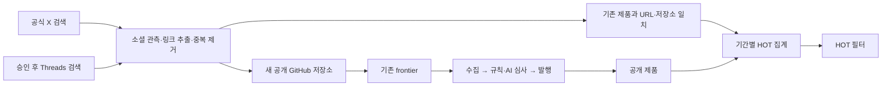

# X·Threads HOT 프로젝트 수집기 가능성 조사

조사일: 2026-10-14 · 범위: 공식 문서와 저장소의 읽기 전용 조사. HOT 기능을 위한 수집기·화면·DB·환경·운영 앱은 구현하거나 변경하지 않았다. API 토큰을 사용한 실제 검색·과금·권한 호출도 실행하지 않았다.

후속 단계에서는 [X 정책·공식 API 파일럿](2026-10-14-x-api-policy-and-pilot.md)을 별도로 준비했다.
아래는 최초 가능성 조사이며, API 접근권과 HOT 사용 목적 승인을 구분한다.
작성자 식별자·독립 작성자 수는 승인 목적과 최소 보존 조건 확인 이후의 조건부 설계다.

## 결론

**X를 먼저 대상으로 삼고, 소셜 게시물의 공개 GitHub 링크를 기존 수집·판정·발행 파이프라인으로 넘기는 MVP는 문서상 가능하다.** X의 공개 반응 수를 두 번 이상 관측하면 최근 증가 속도를 계산할 수 있다. 다만 검색 결과는 설정한 질의에서 관측한 표본이며, 전 세계 모든 프로젝트의 인기 순위가 아니다.

**Threads는 공개 프로젝트 발견에는 쓸 수 있지만, 타인 게시물의 반응 수로 X와 같은 HOT 점수를 계산하는 수집원으로 바로 대체할 수 없다.** `TOP` 검색 결과는 Meta가 정한 인기 검색 순서다. 타인 게시물의 좋아요·댓글·재게시 수를 제공하는 공개 Insights 권한으로 해석하면 안 된다. 공개 검색 승인과 이용 목적 적합성이 선행 조건이다.

**별도 crawler 앱 추가만으로 독립 실행되지 않는다.** 현재 다섯 역할은 역할별 DB lease 소유 후보 한 개만 작업한다. 최소 MVP는 기존 crawler의 새 잡으로 시작하는 편이 작고, 실제 프로세스 격리가 필요하면 새로운 역할과 별도 lease·관측·failover 계약을 설계해야 한다.

## 공식 API 비교

| 항목 | X | Threads |
| --- | --- | --- |
| 검색 | `GET /2/tweets/search/recent`: 최근 7일. `GET /2/tweets/search/all`: 전체 이력, pay-per-use·Enterprise 대상 | `GET /v1.0/keyword_search`: 키워드 또는 topic tag, `TOP`·`RECENT`, `since`·`until` |
| 검색 페이지 | recent 최대 100, full archive 최대 500 | 기본 25, 최대 100 |
| 공개 반응 수 | 공개 게시물의 좋아요·답글·재게시·인용·노출·북마크 수 | 검색 게시물에는 해당 수치가 문서화돼 있지 않음. `has_replies`는 참/거짓 |
| 증가 속도 | 동일 게시물의 시각별 반응 스냅샷 차이로 계산 가능 | 게시물 반응 증가 속도는 현재 공개 검색 필드로 계산 불가. 기간별 발견 게시물·작성자 증가만 자체 관측 가능 |
| 링크 | `entities.urls`의 `expanded_url`·`unwound_url` 등 | `link_attachment_url`·`text`; 검색은 `owner`를 반환하지 않음 |
| 핵심 선행 조건 | 승인된 개발자 계정, Project/App, 앱 Bearer Token, 크레딧·과금 설정 | Meta 앱의 Threads use case, 사용자 OAuth 토큰, `threads_basic`와 승인된 `threads_keyword_search` |

검색 범위·페이지 수는 [X 검색 소개](https://docs.x.com/x-api/posts/search/introduction), [Threads Keyword and Topic Tag Search](https://developers.facebook.com/documentation/threads/keyword-search)에 근거한다. 링크 필드는 [X 데이터 사전](https://docs.x.com/x-api/fundamentals/data-dictionary), [Threads 게시물 조회 필드](https://developers.facebook.com/documentation/threads/retrieve-and-discover-posts/retrieve-posts)에 근거한다.

### X: 공개 게시물 지표와 접근 조건

`public_metrics`의 `like_count`, `reply_count`, `retweet_count`, `quote_count`, `impression_count`, `bookmark_count`는 공개 지표이고 앱 Bearer Token으로 요청할 수 있다. **타인의 공개 게시물을 관측하기 위해 게시물 소유자의 OAuth 승인을 받는 조건은 문서에 없다.** 반대로 URL 클릭·프로필 클릭·organic/promoted 상세 지표는 사용자 인증과 자기 게시물 조건이 적용된다. 따라서 소셜 인기 후보는 찾을 수 있지만, 해당 제품 사이트로 실제 얼마나 방문했는지는 알 수 없다. 공개 노출 수는 고유 방문자 수가 아니며 공개 지표는 광고 반응도 포함할 수 있다. [X Metrics](https://docs.x.com/x-api/fundamentals/metrics)

최근 검색은 앱 기준 450회/15분, 사용자 기준 300회/15분이다. 전체 이력 검색은 앱 기준 1회/초와 300회/15분을 모두 준수해야 한다. 게시물 묶음 조회 `/2/tweets`는 앱 기준 3,500회/15분이다. 요청 횟수 제한과 과금되는 게시물 수는 별개이고, 실제 응답의 `x-rate-limit-*`와 콘솔 한도를 따른다. [X Rate Limits](https://docs.x.com/x-api/fundamentals/rate-limits)

검색 질의는 `has:links`, `url:github.com`, 언어, 키워드, `-is:retweet` 등으로 좁힐 수 있다. 현재 recent endpoint 문서는 `sort_order=recency|relevancy`를 제공한다. `relevancy` 자체가 재현 가능한 반응 수 점수는 아니므로 초기 수집은 시간순에 자체 관측을 붙이는 편이 낫다. [X 검색 소개](https://docs.x.com/x-api/posts/search/introduction), [Recent Search endpoint](https://docs.x.com/x-api/posts/search-recent-posts)

현재 공식 자료에서도 검색 소개·데이터 사전은 `tweet.fields`를, recent endpoint reference는 `post.fields`를 표기한다. 질의 길이 안내도 소개의 일반 512자와 endpoint schema의 4,096자가 다르다. 첫 인증 시험에서는 실제 앱이 받는 파라미터·필드를 확인하고, MVP 질의는 보수적으로 512자 이하로 제한한다. 이번 조사에서 어느 별칭이 실제 호출에 통과하는지는 검증하지 않았다.

### Threads: 검색 한도와 Insights를 구분

`threads_keyword_search`가 승인되기 전에는 인증한 사용자 자신의 게시물만 검색한다. 승인 후 공개 게시물을 검색할 수 있다. **2,200 queries/rolling 24 hours는 keyword search의 사용자별 한도다. 일반 Threads 읽기 전체의 한도로 안내하면 안 된다.** 같은 사용자가 여러 앱을 사용하면 이 검색 한도를 공유하며 같은 키워드 반복도 차감된다. 빈 결과는 이 한도에 포함되지 않고, 민감하거나 공격적인 키워드는 빈 결과가 될 수 있다. `limit`는 최대 100이며, `since` 최저값 안내가 있다고 해서 모든 과거 게시물의 완전한 이력 검색을 보장하는 것은 아니다. [Threads Keyword Search의 Limitations·Permissions·Parameters](https://developers.facebook.com/documentation/threads/keyword-search)

`TOP`은 인기 검색 결과, `RECENT`는 최근 검색 결과다. 검색 API가 반환하는 순서와 노출 시각을 기록할 수는 있으나, `TOP` 위치를 좋아요 수 또는 증가율로 바꾸어 표시할 근거는 없다. 검색은 `owner`를 제외하므로 작성자 중복 통제는 관측한 `username`을 기준으로 하며 핸들 변경에 따른 한계도 남긴다. [Threads Keyword Search](https://developers.facebook.com/documentation/threads/keyword-search)

`GET /{threads-media-id}/insights`의 views·likes·replies·reposts·quotes 등은 **사용자 자신의 게시물**에 대한 Insights다. `threads_manage_insights`를 얻어도 검색으로 발견한 모든 타인의 게시물 반응 수를 읽는 권한은 생기지 않는다. 재게시 facade가 다른 사용자의 게시물이면 빈 결과가 된다는 제한도 명시돼 있다. [Threads Insights API](https://developers.facebook.com/documentation/threads/insights)

공개 프로필 발견은 별도다. `GET /profile_lookup?username=...`와 `GET /profile_posts?username=...`에는 `threads_basic`·`threads_profile_discovery`가 필요하다. public profile 조회는 **100명 이상 팔로워를 가진 공개 프로필만** 반환하고 사용자별 최대 **1,000 requests/rolling 24 hours**가 안내돼 있다. standard access에서는 일부 Meta 공식 계정만 조회된다. 공개 프로필 필드에 `follower_count`와 지난 7일 프로필 게시물의 합산 `likes_count`가 있지만, 특정 제품 게시물의 좋아요 수가 아니다. 이 값을 제품 HOT 점수로 복사하면 다른 글의 인기를 잘못 배정한다. [Threads Profiles](https://developers.facebook.com/documentation/threads/threads-profiles), [Public Profile Posts](https://developers.facebook.com/documentation/threads/retrieve-and-discover-posts/retrieve-posts)

## 요금과 현실적인 예산

X는 선불 크레딧 기반 종량 과금이다. 조사 시 공식 문서의 단가는 반환된 **Post 1개 $0.005**, **User 1개 $0.010**이다. 한 번의 100개 검색 응답은 중복 과금 제외 전 Post 비용 $0.50에 해당한다. pay-per-use는 월 과금 주기당 Post 읽기 300만 개 상한이 있다. 같은 리소스는 UTC 하루 안에서 재조회 과금이 대부분 중복 제거되지만 **soft guarantee**이며 UTC 자정 뒤에는 다시 과금될 수 있다. 소유 데이터 할인 $0.001은 본 수집기의 타인 게시물 검색 예산에 적용하지 않는다. [X Pricing의 Read operations·Owned Reads·Deduplication](https://docs.x.com/x-api/getting-started/pricing)

아래는 30일, 문서 단가 기준의 **가정 계산**이다. 검색 후 탈락한 게시물도 읽기 비용에 들어가며, 여러 날 재관측한 게시물도 그날의 과금 수에 포함해야 한다.

| 하루 과금 대상 Post 수 | Post 비용/월 | 해석 |
| --- | --- | --- |
| 500 | $75 | 좁은 질의·작은 후보 목록의 파일럿 |
| 1,500 | $225 | 질의 확장 또는 여러 날 후보 재관측 |
| 5,000 | $750 | 넓은 검색을 지속하면 작은 서비스에도 부담 가능 |

User 리소스 100개/일을 별도 반환받으면 문서 단가상 월 $30이 추가된다. 첫 파일럿에서는 작성자 ID·프로필 확장을 제외한다. 작성자별 중복 통제는 승인 목적과 최소 식별·보존 조건 확인 후 별도로 설계하며, 해시 ID만으로 익명 집계라고 단정하지 않는다. 실제 리소스별 청구·UTC 중복 제거·환율·세금·가격 변경은 이 계산으로 보장하지 못한다. 개발자 콘솔 단가와 최초 소액 호출의 영수증을 확인한 뒤 일일 리소스 예산·월 spending limit·잔액 중단을 설정한다. AI 심사·서버·DB 비용은 별도다.

읽은 Threads 공식 자료에는 X와 비교할 수 있는 호출별 요금표가 없었다. **API 비용이 영구적으로 0이라고 확정하지 않는다.** 앱 대시보드·승인 조건에서 비용과 실제 한도를 확인해야 한다. 예를 들어 12개 키워드 × 4회/일 × 3페이지 = 144개 검색 요청/일은 문서상 2,200 한도보다 작지만, 다른 앱과 공유한 사용자 예산·재시도·필터링·결과 포괄성은 실호출로 확인해야 한다.

## 이용 목적·권한상의 실무 장애물

X 문서는 공개 표시의 최신 내용 유지와 삭제·비공개화 대응, 콘텐츠 재배포 제한을 둔다. 공개 원문·이미지를 대량으로 복제하거나 외부 API에 소셜 원본을 그대로 내보내는 기능은 별도 설계가 필요하다. MVP는 제품 자체 페이지와 관측 시각·출처 링크를 중심으로 표시하고, 원 게시물 접근 불가·삭제 요청이 있으면 해당 관측을 HOT 자격에서 제외한다. 제품의 소셜 반응을 해석하는 use case와 X 자체 이용량·성능을 평가하는 금지된 benchmarking은 구분해서 개발자 등록에 정확히 설명해야 한다. **API의 기술적 접근 가능성이 모든 상업적 공개 점수 이용의 승인을 뜻하지 않는다.** [X Developer Policy](https://docs.x.com/developer-terms/policy)

Meta의 `threads_keyword_search` 허용 용도는 사용자가 자기 소셜 존재를 관리하고 특정 키워드의 공개 내용을 검색·표시하는 흐름이다. NoMoreVibe가 한 운영자 토큰으로 수집한 내용을 불특정 방문자에게 영구적인 프로젝트 추천 DB로 내보내는 방식은 이 허용 용도에 자동으로 맞는다고 볼 수 없다. 승인 신청에서는 실제 사용 흐름·보관·공개 범위를 그대로 제출해야 하며, 불일치하면 Threads 추가를 보류한다. App Review는 OAuth·계정 연결·키워드 검색 화면 등 실제 흐름을 요구한다. [Meta Permissions: threads_keyword_search](https://developers.facebook.com/documentation/development/permissions#threads_keyword_search)

Meta는 목적에 필요한 데이터 처리, 개인정보처리방침, 보안·삭제 등을 요구한다. 소셜 게시물 원문을 기존 AI 심사 입력으로 보내는 기능은 첫 MVP 범위에서 제외하고, 추출한 공개 저장소를 독립적으로 가져와 기존 저장소·제품 페이지 근거로 판단한다. [Meta Platform Terms](https://developers.facebook.com/terms)

실제 준비 항목은 다음과 같다. 지금 자격 정보를 요청하거나 기존 운영 비밀값을 조회하지 않았다.

| 대상 | 필요 항목 | 이번에 확인하지 않은 것 |
| --- | --- | --- |
| X | 개발자 계정·Project/App, 앱 Bearer Token, 승인된 사용 목적, 결제·크레딧·spending limit | 현재 계정 보유·승인·잔액·호출 성공·실제 청구 |
| Threads | Threads use case의 Meta 앱 ID·secret, 운영 사용자 OAuth, redirect URI, `threads_basic`·`threads_keyword_search` 승인, 공개 범위에 맞는 심사 자료·개인정보/삭제 URL | 현재 앱 승인·사업자 확인 필요 여부·공개 검색 성공·자동 수집 용도 적합성 |
| Threads 공개 프로필 확장 | 위 항목에 `threads_profile_discovery` 및 필요한 access level | 100명 기준으로 놓치는 메이커 규모·조회 성공 |

Threads 사용자 토큰은 기본 1시간이고 서버에서 장기 토큰으로 교환하면 60일이다. 만료 전, 발급 후 최소 24시간이 지난 장기 토큰을 refresh해야 하므로 갱신·만료 관측이 운영 비용에 포함된다. app token만으로 사용자 검색을 대체한다고 가정하지 않는다. [Threads OAuth](https://developers.facebook.com/documentation/threads/get-started/get-access-tokens-and-permissions), [Long-Lived Access Tokens](https://developers.facebook.com/documentation/threads/get-started/long-lived-tokens), [Create an App](https://developers.facebook.com/documentation/threads/get-started/create-an-app)

비공식 내부 API·브라우저 로그인 자동 수집·프록시·캡차 또는 제한 우회는 제안하지 않는다. 권한 또는 요금 때문에 공식 API가 맞지 않으면 해당 소셜 소스를 보류한다.

## 현재 파이프라인과 연결

저장소의 실제 계약은 다음과 같다.

- `crawl_frontier.repo`는 `owner/name` 자연키다. `crawl_documents`·`crawl_candidates`도 GitHub 저장소를 기본으로 연결한다. URL만 가진 일반 소셜 후보를 기존 `repo` 칸에 억지로 넣을 수 없다.
- `crawl.enqueue()`는 대소문자를 무시해 저장소를 중복 제거하며 이미 발견한 행을 덮지 않는다. 첫 발견 `signal`만 남으므로 소셜 관측 이력을 그 한 필드에 모두 보관할 수 없다.
- 현재 추가 입구 `hn-show-seed`도 Show HN의 GitHub 저장소 URL만 받아 기존 프론티어에 넣는다. 첫 social seed의 가장 가까운 사례다.
- 발행은 저장소·제품 URL 중복, 최신 후보·문서·설정 snapshot, enforce 승인 등 기존 publication guard를 통과해 `products.status=seeded`, `source=crawler`로 저장한다. `products.source`는 현재 `skill|crawler`이며 소셜 발견 때문에 `verified`·메이커 소유권·제작 AI를 생성하지 않는다.
- 이미 등록된 제품의 URL 또는 GitHub 저장소가 일치하면 새 제품을 만들지 않고 그 제품에 소셜 관측만 연결해야 한다. 검색 표현인 “built with AI”는 제작 AI 근거 판정과 별개다.
- GitHub 스타 자동 승인은 기존 별도 정책이다. 소셜 좋아요 수를 그 스타 수로 바꾸거나 HOT만으로 심사·스팸 의심 보류를 우회하면 안 된다.

근거 파일: `lib/db/crawl-schema.ts`, `lib/crawl/repository.ts`, `lib/crawl/jobs/hn-show.ts`, `lib/crawl/publish.ts`, `lib/crawl/publication-guard.ts`, `lib/db/schema.ts`, `lib/domain/products/repository-identity.ts`, `README.md`.

제품 URL만 있는 신규 후보는 MVP에서 수집 흔적과 미연결 사유만 남기고 자동 등재하지 않는다. 후속 범위에서 제품 페이지의 명시적 저장소 링크를 안전하게 확인하거나 메이커 등록으로 연결한다. 비공개 저장소·저장소 없는 제품의 일반 URL frontier는 별도 입구와 판정 계약 변경이 필요하다.

## 제안하는 가장 작은 MVP

1. **X 한 소스, 최근 검색, 소수의 명시적 질의로 파일럿한다.** 한국어·영어 제작/출시 표현과 공개 GitHub 링크를 조합한다. 질의당 시간창·페이지·하루 반환 리소스 상한을 둔다. 초기에는 최근 24시간 게시물만 발견하고, 후보만 수 시간 뒤 재조회한다. full archive·stream·팔로워 전수 수집은 첫 범위에 필요하지 않다.
2. **링크와 제품의 신원을 먼저 확정한다.** `expanded_url`/`unwound_url`을 이용하고 HTTP(S)만 허용한다. 링크 게시물이 SNS·뉴스·광고·모음글을 가리킬 수 있으므로 목적 제품·공개 저장소와 연결되는지 확인한다. 기존 `normalizeUrl()`은 쿼리·해시를 제거하므로 앱 식별자가 쿼리에 있는 URL은 별도로 보류하고 다른 제품을 임의로 합치지 않는다. 제한된 redirect 해제는 기존 SSRF·DNS·바이트·시간·origin 제한을 유지한다. 무한 링크 탐색은 하지 않는다.
3. **소셜 관측과 admission을 분리한다.** 소셜별 게시물 ID로 원천 중복을, GitHub 숫자 ID·저장소 canonical key·기존 제품 URL로 제품 중복을 통제한다. 동일 게시물의 여러 질의 일치·재게시를 중복 가산하지 않는다. 제품별 게시물 수·광고 공개 여부·스팸 의심·차단·삭제 상태를 반영한다. 작성자별 중복·기여 상한은 승인 목적과 최소 식별·보존 조건 확인 후 별도로 설계하며 첫 파일럿은 작성자 ID를 보관하지 않는다. 플랫폼 봇 판별 서비스로 홍보하지 않는다.
4. **기존 심사·발행을 그대로 거친 공개 제품만 HOT 목록에 올린다.** 높은 반응 수는 후보 수집 우선순위에 제한적으로 반영할 수 있으나 제작 근거·제품 적합성·도메인 소유권을 대신하지 않는다.
5. **점수는 기간과 관측 한계를 함께 표시한다.** 기본 최근 24시간, 저빈도 제품은 최근 7일 보조 관측을 따로 둔다. 공개 숫자의 결측은 0과 구별한다. 첫 관측만 있으면 반응 총량만 계산하고 “증가율”은 보류한다. 두 시각 이상이면 `max(0, 최신 수 - 이전 수) / 경과시간`을 기록하고 감소·삭제·결측 상태도 남긴다. 반응 종류별 로그 완화·게시물별 상한·최근성 감쇠를 조합하되 가중치·최소 관측 수는 실제 표본을 보고 정한다. 독립 작성자 수는 승인 목적과 최소 식별·보존 조건이 확인된 경우에만 추가한다. 노출을 고유 인기로 간주하지 않는다.
6. **HOT 조회를 미리 계산한 snapshot으로 제공한다.** 페이지 요청이 X·Threads API를 직접 호출하지 않는다. 수집 장애·예산 소진 시 마지막 관측 시각과 stale 상태를 표시하고, 만료된 HOT 자격을 숨긴다. HOT 수집 성공·제품 연결·프론티어 접수·심사 대기·발행·최신 관측은 각각 측정한다.

이 MVP가 찾는 대상은 “우리가 정한 소셜 검색에서 최근 반응이 관측된 프로젝트”다. Threads를 추가한다면 `TOP` 발견 신호 또는 독립 작성자 언급 수 신호로 표시하고, 타인 게시물 반응 점수가 없는 Threads 데이터를 X 반응 점수와 같은 단위로 합산하지 않는다.

## 필요한 최소 데이터 계약과 화면 접점

구현 시 기존 `products.source`나 영구 `is_hot` 값 하나에 출처·점수·신선도를 섞지 않는 편이 낫다. 최소 두 저장 단위면 충분하다.

| 저장 단위 | 필요한 값 | 이유 |
| --- | --- | --- |
| 소셜 관측 | platform, post ID, permalink, 질의/검색 유형, 게시 시각·관측 시각, 추출 링크·canonical key, 공개 지표와 결측 상태, product slug 또는 repo 연결, 미연결·삭제·차단 상태. 작성자 식별자는 승인 목적/최소 보존 확인 후의 선택 항목 | 재조회·출처·중복·누락 원인을 보존. 한 게시물의 두 관측을 재현 가능하게 연결 |
| 제품 HOT snapshot | product slug, platform/신호 종류, window start/end, last observed at, score·scoring version, 반응 차이·관측 수, 자격 만료 시각·stale 사유. 독립 작성자 수는 승인된 식별 설계가 있을 때만 추가 | 목록 조회와 만료를 빠르게 처리하고 계산 규칙 변경을 추적 |

공개 원문과 프로필 개인정보를 무기한 보관하지 않으며 플랫폼 삭제·접근 변화에 따라 연관 관측과 snapshot을 무효화할 수 있어야 한다. 여러 게시물이 같은 제품에 연결되는 것은 자연스러운 관계이고, 한 게시물이 여러 제품을 소개하면 반응 전량을 모든 제품에 복제하지 않는다. 첫 MVP에서는 제품 하나로 확정되는 게시물만 점수에 사용한다.

현재 `components/home/browse-state.ts`의 `trending`은 NoMoreVibe 방문 증가를 뜻한다. 현재 탭 `ai/recent/all-time` 중 `all-time`은 GitHub 스타 순이다. HOT는 새 `sort=hot` 등 명시적 상태로 추가하고 기존 증가·스타 탭 의미를 바꾸지 않는다. 분야·검색 조건, 카드 수·분야 수, “더 보기”, locale, 공유 URL을 같은 HOT 자격으로 계산한다. 카드는 “X에서 최근 24시간 반응 관측”·마지막 확인·출처 링크 수준으로 근거를 알려야 한다. 기존 경쟁 시즌 순위는 검증된 제품의 NoMoreVibe 유입 지표를 사용하므로 소셜 점수를 섞지 않는다.

화면/조회 접점: `components/BrowseFilters.tsx`, `components/home/browse-state.ts`, `components/DiscoveryBoards.tsx`, `lib/domain/products/repository.ts`, i18n 메시지와 해당 목록 테스트. 이는 향후 수정 대상의 제안이며 이번에 편집하지 않았다.

## 운영 분리 선택지

| 선택지 | 실행 구조 | 판단 |
| --- | --- | --- |
| 기존 crawler 새 잡 | `social-hot-seed` 같은 새 job과 별도 커서·API 예산·설정. main lane에서는 기존 잡과 순차 실행 | **최소 MVP 권장.** 운영 앱·역할 추가가 필요 없지만 시간이 길어지면 기존 수집 대기 증가 |
| 기존 crawler 새 lane | 같은 역할 lease·같은 활성 프로세스 안의 별도 lane | API 대기는 격리 가능. 프로세스·DB pool·장애·재시작은 공유하므로 완전 독립 앱은 아님 |
| 새 social 역할 | `JobRole`·catalog·별도 role lease·주/예비·health/progress·scheduler·배포·비밀값 범위를 새로 정의 | 실제 독립 실행 요구를 충족. 첫 파일럿보다 변경·검증 범위가 큼 |

현재 코드의 `JobRole`은 `crawler|reviewer|publisher|text|maintenance`이고 `JobLane`은 `main|sources|evidence|scan|stars`다. `sources`는 이번 수집·검수 개선에서 추가한 공개 근거 갱신 전용 lane이며, 역할 lease는 그대로다. 단순히 앱 이름을 `hot-crawler`로 바꾸고 `--role=crawler`를 유지하면 기존 주·예비와 같은 lease를 경쟁한다. lease를 우회하는 legacy worker를 병행 배포하면 기존 단일 활성 후보·failover 계약을 깨므로 선택지로 삼지 않는다. 근거: `lib/jobs/catalog.ts`, `lib/jobs/role-leader.ts`, `scripts/worker.ts`, `docs/operations/independent-workers-runbook.md`.

어느 선택지든 기존 GitHub 수집 예산과 소셜 검색 예산은 각각 관측하고, reviewer·publisher backlog에 따라 신규 social admission을 양보해야 한다. 기존 URL origin 제한이 프로세스 내부 큐인 부분은 독립 프로세스끼리 자동 공유되지 않으므로 API·대상 origin의 동시에 요청하는 수를 다시 검증한다.

## 실행 전 확인할 항목과 조사 검증 상태

첫 단계의 합격 조건은 코드량이 아니라 **공식 계정에서 공개 검색이 실제 성공하고, 반환 링크·지표·요금으로 작은 표본을 재현할 수 있는가**다. 그 뒤 연결 성공률·기존 중복 비율·스팸 의심 비율·심사 대기·일일 비용으로 공개 HOT 가치와 부담을 평가한다. 실제 표본 없이 프로젝트 수·추가 발행량·운영 비용을 확정하지 않는다.

- X: 타인의 공개 게시물 `public_metrics`와 링크 필드, 파라미터 이름, pagination·삭제/비공개 오류, 재관측의 실제 과금 확인.
- Threads: `threads_keyword_search` 공개 검색 승인과 실제 허용 use case가 먼저. 승인 후 `TOP/RECENT`·링크·사용자별 예산 확인. 공개 반응 수가 없다는 현재 계약이 바뀌었는지 재확인.
- 파이프라인: 기존 제품 연결과 새 저장소 admission을 구분하고, 심사·발행 backlog/오류 상태를 보존. HOT 자격 만료와 수집 중단 상태를 UI에 검증.
- 이번 검증: 공식 웹 문서 읽기와 저장소 코드/문서 읽기만 수행. 인증 API·운영 DB·Dokploy·UI를 호출하거나 변경하지 않았다. 구현 테스트·typecheck·build는 미실행이며 통과로 기록하지 않는다.

Meta legacy `/docs/threads/*`는 웹 도구에서 429 또는 fetch 실패였다. 같은 공식 URL에 일반 `curl -L` GET을 한 결과 신규 `/documentation/threads/*`로 이동했고 HTTP 200 문서 본문을 읽었다. 인증·프록시·우회 헤더를 사용하지 않았다. Meta의 공식 [문서 index](https://developers.facebook.com/documentation/threads/llms.txt)로 새 경로를 확인했다. [공식 Postman workspace](https://www.postman.com/meta/threads/overview)도 확인했지만 최신 기능의 권위는 개발자 문서라고 명시하므로 핵심 한도·권한은 신규 공식 문서에 근거했다. 비공식 scraper·요금 비교 블로그는 결론의 근거로 사용하지 않았다.

읽거나 키워드 검색한 저장소 파일/발췌: `AGENTS.md`, `README.md`, `docs/operations/independent-workers-runbook.md`, `lib/db/schema.ts`, `lib/db/crawl-schema.ts`, `lib/jobs/catalog.ts`, `lib/jobs/registry.ts`, `lib/jobs/role-leader.ts`, `lib/jobs/runner.ts`, `lib/crawl/repository.ts`, `lib/crawl/jobs/hn-show.ts`, `lib/crawl/jobs/fetch.ts`, `lib/crawl/publish.ts`, `lib/crawl/publication-guard.ts`, `lib/crawl/spam-signals.ts`, `lib/crawl/rules.ts`, `lib/domain/products/repository.ts`, `lib/domain/products/repository-identity.ts`, `lib/net/normalize.ts`, `components/BrowseFilters.tsx`, `components/home/browse-state.ts`, `components/DiscoveryBoards.tsx`, `scripts/worker.ts`, `tests/integration/discovery-feeds.test.ts`.

소셜 조사의 산출물은 이 보고서다. 병행한 기존 수집·검수 개선은 [별도 구현 보고서](2026-10-14-pipeline-recovery-implementation.md)를 따르며, HOT 기능의 구현으로 계산하지 않는다.
