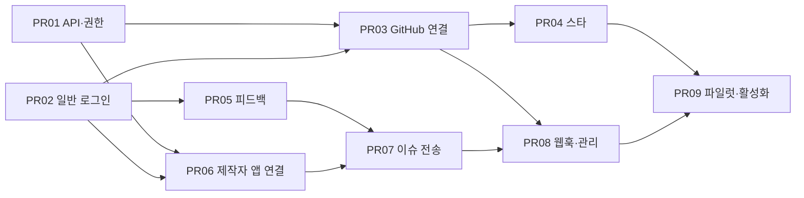

# GitHub 스타·피드백 연동 — PR 단위 구현 계획

> **For agentic workers:** 실행 시 사용 가능한 `execute-plan` 스킬로 PR을 하나씩 진행한다. 각 체크박스는 실행 후에만 완료한다. 서브에이전트 또는 Codex CLI를 사용하게 되면 저장소 규칙대로 `gpt-6.1-sol`, reasoning effort `xhigh`를 사용한다.

**Goal:** NoMoreVibe에서 누른 GitHub 스타는 사용자의 실제 GitHub 계정에 반영하고, 제작자가 연동한 저장소에는 사용자가 동의한 피드백을 NoMoreVibe 앱 봇의 이슈로 전달한다.

**Architecture:** 일반 서비스 계정과 GitHub 쓰기 권한을 구분한다. 개인 스타에는 GitHub App user access token, 피드백에는 제작자가 선택한 저장소의 installation access token을 사용한다. 피드백 저장과 전송 대기 등록은 같은 PostgreSQL 트랜잭션으로 처리하고, 외부 전송의 불명확한 결과는 재조회한 뒤 처리한다.

**Tech Stack:** 현재 Next.js 16.3.8 App Router, React 19, TypeScript, PostgreSQL/Drizzle, 기존 worker·job lease·rate limit·credential vault, GitHub REST API. 이메일 로그인은 Resend HTTP API로 구현한다.

기준: 2026-10-11, 로컬·원격 main `6839194dc47e1f1993f54471c0fb94b6857cd6aa`. 같은 날 읽은 공개 health의 mini-web 릴리스도 이 SHA였다. 초안은 구현 전 계획이었다. 사용자 승인 후 아래 코드 항목을 실행했으며 최종 커밋·검사 기록은 [구현 기록](../../operations/2026-10-11-github-integration-implementation.md)에 남긴다. 후속 사용자 요청으로 PR #356 push·CI·병합과 운영 코드·DB·14앱 배포를 완료했다. [배포 검증](../../operations/2026-10-11-github-integration-rollout.md)을 따른다. 실제 App 등록·외부 쓰기·활성화·파일럿은 계속 미검증이다.

## 1. 로그인 질문에 대한 답

| 행동 | 개인 GitHub 연결 | 추가 조건 |
|---|---|---|
| 제품 보기·현재 브라우저 저장 | 불필요 | 현재 동작 유지 |
| 본인 이름으로 GitHub 스타 추가/취소 | 필수 | 본인이 앱의 스타 쓰기 권한을 승인 |
| 서비스에 일반 피드백 작성 | 불필요 | 이메일 인증 등 NoMoreVibe 계정으로 로그인 |
| 피드백을 앱 봇의 GitHub 이슈로 전송 | 작성자는 불필요 | 제작자가 앱 설치·대상 저장소·전송 사용을 설정하고, 작성자가 GitHub 공개에 동의 |
| 작성자 본인 이름으로 GitHub 이슈 생성 | 필수 | 작성자 권한과 앱의 해당 저장소 접근이 추가로 필요. 이번 권장 MVP의 전송 방식은 봇 |

GitHub 로그인 화면은 연결·재연결 시 필요하며 매 클릭마다 로그인시키지 않는다. 서비스 로그인 성공만으로 GitHub 스타 권한이나 제품 관리 권한을 부여하지 않는다. GitHub에서 보는 이슈 작성자는 앱 봇이고, 본문에 NoMoreVibe 작성자 닉네임과 원문 링크를 표시한다. [개인 계정으로 동작하는 GitHub App 인증](https://docs.github.com/en/apps/creating-github-apps/authenticating-with-a-github-app/authenticating-with-a-github-app-on-behalf-of-a-user), [설치 계정으로 동작하는 인증](https://docs.github.com/en/apps/creating-github-apps/authenticating-with-a-github-app/authenticating-as-a-github-app-installation).

## 2. 선택한 구성과 대안

| 구성 | 효과 | 판단 |
|---|---|---|
| 개인 스타 + 봇 피드백 + 이메일 로그인 | GitHub 계정이 없는 사람도 피드백 가능. 제작자가 저장소별로 수신을 선택 | 권장안. 사용자에게 제시한 작성자 선택 질문에 답이 없으면 이 가정으로 검토 |
| 스타·이슈를 모두 사용자 GitHub 명의로 생성 | GitHub에서 작성자 신원이 직접 드러남 | 모든 참여자가 GitHub 연결해야 하고 이슈 쓰기·저장소 접근 조건도 필요 |
| GitHub의 스타/새 이슈 화면으로 이동 | 토큰 보관과 자동 전송을 줄임 | 사이트 안에서 반영 결과를 보장하는 요청을 충족하지 못함 |

첫 MVP 범위는 공개 GitHub 저장소, 개인 스타, 텍스트 피드백, 앱 봇 이슈, 이슈 상태 표시다. 크레딧·Agent 테스트·파일 업로드·릴리스 연결·자동 수정·비공개 저장소는 기존 사업안의 별도 개발 범위다. 이메일 로그인은 GitHub 연결이 없는 피드백 참여자를 지원하기 위한 이번 범위에 포함한다.

### 현재 코드에서 재사용할 지점

- `app/api/auth/github/{route.ts,callback/route.ts}`, `lib/auth/{oauth,session}.ts`는 관리자 전용이다. 현재 `read:user` 권한이며 일반 사용자는 거부한다. 이 경로·쿠키를 일반 사용자 권한으로 확대하지 않고 새 공개 인증 경로를 만든다.
- `components/StarMetric.tsx`는 관측한 GitHub 수치 표시, `components/product-detail/SaveButton.tsx`와 `components/home/saved.ts`는 localStorage 저장이다. 새 GitHub 스타 버튼을 별도로 추가한다.
- `lib/domain/products/maker-auth.ts`의 제품 수정키 인증과 `lib/domain/products/actor.ts`를 제품 설정 권한 경계로 재사용한다. GitHub 저장소 관리 권한은 별도로 확인한다.
- `lib/crawl/github-apps.ts`는 읽기용 수집 App이다. 수집 자격·테이블·토큰 풀의 권한은 그대로 두고 별도 연동 App과 비밀키를 둔다. RS256 JWT 순수 함수와 `lib/operations/credential-vault.ts`의 암호화 도구만 재사용한다.
- `lib/jobs/control.ts`의 `requestJob`은 신호이며 페이로드 큐가 아니다. 전송할 피드백은 별도 outbox에 저장한다.
- DB 쓰기·인증·내 피드백 조회는 primary DB를 사용한다. 개인별 API는 `private, no-store`; 로그인 상태·스타 상태를 공개 CDN 응답에 포함하지 않는다.

### 앱과 권한

| 용도 | 인증 | 요청 권한 |
|---|---|---|
| NoMoreVibe Star App | 각 사용자 승인 → user access token | User `Starring: write`, Repository `Metadata: read` |
| NoMoreVibe Feedback App | 제작자가 선택한 저장소에 설치 → installation token | Repository `Issues: write`, `Metadata: read` |

스타 API는 `GET/PUT/DELETE /user/starred/{owner}/{repo}`를 사용한다. 봇의 스타를 여러 이용자의 스타처럼 더하지 않는다. 스타 App으로 타인의 공개 저장소에 별을 남길 수 있는지는 **PR-01의 실제 권한 검증 완료 조건**으로 먼저 확인한다. 제작자의 Feedback App 설치 없이 스타가 동작해야 한다. 더 넓은 OAuth `public_repo` 권한으로 조용히 대체하지 않는다. [스타 API와 요구 권한](https://docs.github.com/en/rest/activity/starring#star-a-repository-for-the-authenticated-user).

피드백 App은 `POST /repos/{owner}/{repo}/issues`를 사용한다. 미설치·권한 회수·Issues 비활성·보관된 저장소에는 자동 전송을 끈다. [이슈 생성 API](https://docs.github.com/en/rest/issues/issues#create-an-issue).

## 3. PR 순서와 완료 결과

번호는 이번 계획의 순번이며 실제 GitHub PR 번호는 아니다.

| PR | 제목 / 결과 | 선행 |
|---|---|---|
| PR-01 | GitHub API 클라이언트·권한 검증: 최소 권한으로 가능한 경로를 고정 | 없음 |
| PR-02 | 일반 사용자 계정·이메일 로그인: GitHub 없이 피드백에 참여할 기반 | 없음 |
| PR-03 | 개인 GitHub 연결·토큰 수명주기: 스타 권한 승인·재연결·해제 | 01, 02 |
| PR-04 | GitHub 스타 버튼·등록/취소: 실제 개인 스타가 반영되는 첫 기능 | 03 |
| PR-05 | 서비스 피드백 저장·조회·폼: 외부 연동이 없어도 피드백 접수 가능 | 02 |
| PR-06 | 제작자의 Feedback App 설치·저장소 연결: 전송 대상과 권한 확정 | 01, 02 |
| PR-07 | 피드백 → GitHub 이슈 전송: 정상 전송·보류·중복 방지 | 05, 06 |
| PR-08 | 웹훅·재조회·관리 화면: 권한 회수와 이슈 상태를 반영 | 03, 07 |
| PR-09 | 실제 파일럿·운영 활성화: 두 웹·주/예비 워커에서 결과 검증 | 04, 08 |



스타는 PR-04 완료 후 제한 파일럿으로 먼저 열 수 있다. 피드백 접수는 PR-05에서 동작하고, GitHub 전송은 PR-07~08까지 갖춘 뒤 연다. 초기에는 모든 새 기능 플래그를 끈 채 병합한다.

## 4. 공통 데이터·API 계약

아래는 계획에서 사용하는 새 타입과 필드 계약이다. 기존 파일에 이미 구현된 타입이 아니다.

```ts
type GithubConnectionState = 'active' | 'needs_reconnect' | 'revoked';
type GithubStarState = 'starred' | 'unstarred' | 'unknown' | 'needs_reconnect';
type FeedbackKind = 'bug' | 'feature' | 'question';
type FeedbackReviewState = 'accepted' | 'held' | 'rejected';
type IssueDeliveryState = 'local_only' | 'queued' | 'sending' | 'delivered'
  | 'retry_wait' | 'uncertain' | 'blocked' | 'cancelled';
type ExternalIssueState = 'open' | 'closed' | 'deleted' | 'unknown';

type StarWrite = { starred: boolean; operationId: string; expectedRevision: number };
type FeedbackWrite = {
  requestId: string;
  kind: FeedbackKind;
  title: string;
  body: string;
  serviceDisclosureConsent: boolean;
  sendToGithub: boolean;
  githubDisclosureConsent: boolean;
};
```

| 테이블 | 담당 PR / 핵심 제약 |
|---|---|
| `public_users`, `public_identities`, `public_sessions`, `email_login_challenges` | 02. identity `(provider, subject)` unique; 세션·OTP 원문은 저장하지 않고 해시/HMAC; 이메일은 검증 후 identity 등록 |
| `github_user_connections`, `github_auth_flows` | 03. GitHub 숫자 user ID unique; 암호화 access/refresh token과 만료 시각; 흐름은 actor·목적·브라우저 nonce·10분 만료에 묶고 한 번만 소비 |
| `github_star_operations` | 04. `(user_id, repository_id)` unique, revision 증가; 개인 관측 상태와 요청 ID 기록 |
| `product_feedback` | 05. product ID·author user ID·원문·서비스 공개/GitHub 전송 동의·검토 상태·검토자/사유; `(author_user_id, request_id)` unique. 같은 키의 다른 본문은 409 |
| `github_product_bindings` | 06. product ID당 현재 연결 하나; repository 숫자 ID·installation ID·동의자·binding revision·enabled. 개인/조직 설치 모두 지원 |
| `github_issue_outbox` | 07. feedback ID당 이슈 생성 작업 하나; target repository ID와 binding revision 고정; payload hash·attempt ID·dispatch 시각·결과 URL |
| `github_webhook_events`, `github_integration_actions` | 08. delivery UUID 전역 PK·app/hash 충돌 거절; 검증된 최소 이벤트 및 관리자 재처리 감사 기록 |

마이그레이션은 기준 SHA의 마지막 `0065_intro_correction_requests.sql` 다음부터 `0066_public_user_auth.sql`, `0067_github_user_connections.sql`, `0068_github_star_operations.sql`, `0069_product_feedback.sql`, `0070_github_product_bindings.sql`, `0071_github_issue_outbox.sql`, `0072_github_webhook_recovery.sql`로 구현했다. 각 PR을 최신 base로 올릴 때 번호 충돌만 재확인하며 Drizzle meta와 테스트 스키마도 함께 갱신한다. 기존 데이터를 변형하는 백필은 필요 없다.

### 요청 경계

- 모든 쓰기는 서버에서 세션·Origin·CSRF nonce를 검사한다. 브라우저가 보낸 owner/repo/user ID로 GitHub를 호출하지 않는다. slug의 현재 product에서 대상 URL을 읽어 고정 GitHub API origin으로 해석한다.
- 공개 저장소의 숫자 ID·현재 이름을 서버에서 확인한다. 이름 변경은 같은 ID로 따라가며, 삭제 후 같은 이름에 생긴 새 저장소는 같은 대상으로 보지 않는다.
- 관리자 세션 `nmv_admin`, 일반 세션 `nmv_user`, 제품 수정키는 서로 대체되지 않는다.
- 초기 한도: 스타 user당 30회/분, 피드백 user당 5회/시간·20회/일, 연동한 repo당 이슈 생성 최대 20건/일. 기존 공유 DB `rateLimit` 사용. 수치는 파일럿 관측 후 설정으로 조정한다.
- 기능 플래그: `PUBLIC_USER_AUTH_ENABLED`, `GITHUB_STAR_ENABLED`, `PRODUCT_FEEDBACK_ENABLED`, `GITHUB_FEEDBACK_DELIVERY_ENABLED`. 초기값 false. 전송 플래그를 끄면 새 외부 쓰기를 멈추며 저장된 피드백과 결과는 유지한다.

## 5. PR별 실행·검증 범위

### PR-01 — 공통 GitHub 클라이언트와 권한 검증

**파일:** Create `lib/github/{client,repositories,app-jwt}.ts`, `tests/github-integration-client.test.ts`, `docs/operations/github-integration-capability-check.md`; Modify `lib/crawl/github-apps.ts`, `tests/github-apps.test.ts`.

- [x] 타임아웃·401·403 제한·404·410·422·5xx·JSON 크기 오류를 반환하는 테스트부터 작성한다. JWT 순수 함수 추출의 기존 수집 동등성도 검사한다.
- [x] GitHub origin 고정, redirect 자동 추적 금지, API 버전 `2026-03-10`, body/headers 허용 목록, 토큰 비노출 오류 코드를 구현한다. repository 이동은 숫자 ID를 재확인한 뒤 명시적으로 처리한다.
- [x] transport 결과는 `confirmed_success`, `confirmed_rejection`, `unknown`으로 구분한다. POST가 전송된 뒤 네트워크/5xx 결과가 불명확하면 `unknown`이다.
- [ ] 문서에 Star App·Feedback App 권한/콜백/웹훅 설정표와 사용자 승인 테스트를 남긴다. 실제 검증은 작성자가 승인한 테스트 계정·테스트 저장소에서만 시행한다.
- [ ] **완료 기준:** maker 앱을 설치하지 않은 공개 테스트 레포에 user token으로 스타→조회→취소 확인, 설치 token으로 별도 테스트 레포에 봇 이슈 1건 생성 확인. 미승인 이슈 권한 요청은 없음. 실검증이 준비되지 않았다면 capability 완료로 표시하지 않는다.
- [x] `npx vitest run tests/github-integration-client.test.ts tests/github-apps.test.ts`와 공통 CI를 실행하고 결과를 문서화한 뒤 이 PR 파일만 커밋한다.

이 PR의 실제 자격 검증이 실패하면 좁은 권한 구조의 제한을 보고하고 계획을 수정한다. mock 테스트 성공만으로 제품 전체에 권한이 있다고 주장하지 않는다.

### PR-02 — 일반 사용자 세션과 이메일 로그인

**파일:** Create `lib/db/public-user-schema.ts`, `lib/domain/accounts/{repository,session,email-login,email-delivery,request-auth}.ts`, `lib/domain/github-integration/flags.ts`, `app/login/page.tsx`, `app/api/auth/user/email/{start,verify}/route.ts`, `app/api/auth/user/logout/route.ts`, `app/api/me/route.ts`, `components/auth/EmailLoginForm.tsx`, `tests/public-user-auth.test.ts`, `tests/integration/public-user-auth.test.ts`, `tests/e2e/public-user-auth.spec.ts`, migration 0066; Modify `lib/db/schema.ts`, `.env.example`, `tests/integration/setup.ts`, `components/home/SiteHeader.tsx`.

- [x] 만료·틀린 코드·5회 소진·두 요청의 동시 OTP 소비·위조 세션·관리자/일반 쿠키 혼동·외부 return URL 차단 테스트를 먼저 작성한다.
- [x] 세션은 random 32-byte opaque token, DB에는 SHA256 해시, HttpOnly/Secure/SameSite=Lax `nmv_user`, 최대 30일. 로그인 성공 시 세션을 회전하고 로그아웃 시 서버에서 폐기한다.
- [x] 이메일 코드는 8자리·10분·최대 5회 검증. 발송 요청은 이메일당 15분 3회·하루 10회와 신뢰 IP당 15분 20회로 제한한다. 한 이메일의 이전 challenge를 교체할 때도 DB 잠금을 사용한다.
- [x] Resend `POST /emails`를 native fetch로 사용하고 challenge ID를 `Idempotency-Key`로 보낸다. `LOGIN_EMAIL_API_KEY`, `LOGIN_EMAIL_FROM`, `PUBLIC_AUTH_SECRET`을 서버 전용으로 설정한다. 키·OTP·이메일 원문은 로그에 넣지 않는다. [이메일 전송과 요청 중복 방지](https://resend.com/docs/api-reference/emails/send-email).
- [x] **완료 기준:** GitHub 계정이 없는 사용자가 이메일 인증 후 로그인하고 `/api/me`로 일반 user ID를 얻는다. 일반 세션으로 `/admin` 접근 불가. OTP 원문·세션 원문 DB 보관 없음.
- [x] `npx vitest run tests/public-user-auth.test.ts` / `npm run test:integration -- tests/integration/public-user-auth.test.ts` / `npx playwright test tests/e2e/public-user-auth.spec.ts`를 실행한다. 메일은 테스트 어댑터로 검사하고 실제 수신은 지정한 파일럿 주소로만 확인한다.

### PR-03 — 개인 GitHub 연결과 토큰 수명주기

**파일:** Create `lib/db/github-user-schema.ts`, `lib/domain/github-user/{authorization,credentials,repository}.ts`, `app/api/auth/user/github/{route.ts,callback/route.ts}`, `app/api/me/github/route.ts`, `components/auth/GithubConnection.tsx`, `tests/github-user-connection.test.ts`, `tests/integration/github-user-connection.test.ts`, migration 0067; Modify `lib/db/schema.ts`, `app/login/page.tsx`, `.env.example`.

- [x] state/PKCE 불일치·다른 사용자의 연결 탈취·중복 GitHub ID·토큰 갱신 경합·401 권한 회수·비활성 플래그를 실패 테스트로 작성한다.
- [x] Star App 승인은 `state`와 PKCE S256, `offline_access`, 고정 callback으로 처리한다. access/refresh token과 서버가 반환한 각각의 만료를 저장한다. 갱신은 짧은 DB transaction에서 connection의 refresh lease·token revision을 선점하고 transaction 밖에서 요청한다. 소유자·revision이 일치할 때만 새 토큰을 원자적으로 교체한다. 갱신 응답이 불명확하거나 실행이 종료되면 소비됐을 수 있는 refresh token으로 자동 재요청하지 않고 재연결을 요구한다. [GitHub user token 발급·갱신](https://docs.github.com/en/apps/creating-github-apps/authenticating-with-a-github-app/generating-a-user-access-token-for-a-github-app).
- [x] 이미 이메일 로그인한 사용자는 그 계정에 GitHub identity를 연결한다. 로그아웃 상태에서 GitHub를 연결하면 검증한 GitHub 숫자 ID로 일반 계정을 찾거나 만든다. 이메일 주소 일치만으로 계정을 자동 병합하지 않는다.
- [x] 별도 `GITHUB_INTEGRATION_SECRET`으로 암호화하며 관리자 OAuth·수집 PAT·읽기 App을 사용하지 않는다. 연결 해제는 local 토큰을 폐기하고 새 요청을 차단한다. 과거 GitHub 스타는 유지한다.
- [x] **완료 기준:** 관리자 제한 없이 일반 사용자가 연결 가능, 사용자에게 스타 권한임을 표시, 동의 거절/회수 시 다시 연결할 안내가 나오며 이슈 쓰기 권한은 요구하지 않는다.
- [x] `npx vitest run tests/github-user-connection.test.ts` / `npm run test:integration -- tests/integration/github-user-connection.test.ts`와 관리자 로그인 회귀 `npx vitest run tests/session.test.ts`를 실행한다.

### PR-04 — 실제 GitHub 스타 추가·취소와 버튼

**파일:** Create `lib/db/github-star-schema.ts`, `lib/domain/github-stars/{repository,service}.ts`, `app/api/products/[slug]/github-star/route.ts`, `components/product-detail/GithubStarButton.tsx`, `tests/github-star-action.test.ts`, `tests/integration/github-star-action.test.ts`, `tests/e2e/github-star-action.spec.ts`, migration 0068; Modify `lib/db/schema.ts`, `app/p/[slug]/page.tsx`, 상세 액션 컴포넌트.

- [x] 기존 스타·취소·두 탭 동시 요청·같은 operationId 재전송·오래된 revision·계정 미연결·repo 교체·응답 불명확·lease 만료 뒤 늦게 도착한 upstream 응답 테스트를 먼저 작성한다.
- [x] GET은 본인의 현재 스타 상태, PUT은 `StarWrite`의 원하는 최종 상태를 받는다. 서버는 upstream PUT/DELETE를 사용한다. 같은 user×repo 작업에 짧은 DB lease를 잡고, 이전 요청의 상태가 불명확하면 먼저 조회한다. 장시간 외부 호출 중 DB transaction을 열어 두지 않는다.
- [x] `operationId` 재요청은 저장한 결과를 반환한다. lease 소유권을 잃은 요청은 현재 revision을 덮지 못한다. 서버 간 경합은 409와 재조회로 처리한다. lease 만료를 upstream 요청 종료의 증거로 사용하지 않는다. 실행 중에는 반대 동작을 받지 않고, 종료 후 timeout 결과는 `unknown`으로 유지하며 지연 재조회를 수행한다. 자동 복구가 필요하면 같은 desired state의 멱등 요청만 수행한다. 두 복제본의 DB fence만으로 GitHub 쓰기 순서까지 보장한다고 주장하지 않는다.
- [x] 버튼은 연결 필요·조회 중·스타됨·처리 중·재연결·확인 불가를 표시한다. 실패를 스타 성공처럼 표시하지 않는다. 기존 저장 버튼과 개인 GitHub 스타는 다른 버튼이다.
- [ ] **완료 기준:** 테스트 사용자의 GitHub 레포 페이지/개인 starred 상태와 사이트 버튼이 일치. 이미 스타된 레포에 다시 눌러 중복 증가 없음. 공개 `products.stars`·하루 평균 증가의 관측 로직을 클릭 때 임의 +1/-1 하지 않는다.
- [x] `npx vitest run tests/github-star-action.test.ts tests/star-change.test.ts` / `npm run test:integration -- tests/integration/github-star-action.test.ts` / `npx playwright test tests/e2e/github-star-action.spec.ts`를 실행한다.

### PR-05 — 서비스 피드백 접수·조회

**파일:** Create `lib/db/product-feedback-schema.ts`, `lib/domain/feedback/{contract,repository,submit,review}.ts`, `app/api/products/[slug]/feedback/route.ts`, `app/api/me/feedback/route.ts`, `app/feedback/[id]/page.tsx`, `app/admin/feedback/{page.tsx,actions.ts}`, `components/product-detail/{FeedbackForm,FeedbackList}.tsx`, `tests/product-feedback.test.ts`, `tests/integration/product-feedback.test.ts`, `tests/e2e/product-feedback.spec.ts`, migration 0069; Modify `lib/db/schema.ts`, `app/p/[slug]/page.tsx`, 관리자 내비게이션.

- [x] 미로그인·차단 제품·동시 중복 제출·키 같고 본문 다름·다른 사용자 비공개 항목 조회·GitHub 동의 누락·원문 HTML 표시 테스트를 작성한다.
- [x] `FeedbackWrite` 검증: title 1~120자, body 1~5,000자, 지원 종류 3개, requestId UUID. 세션에서 작성자를 결정한다. UI에 서비스의 공개 게시임을 명시하고 `serviceDisclosureConsent: true`를 추가로 요구한다. GitHub 공개 동의는 별도 필드로 보관한다. 공개 목록/원문 링크는 accepted 항목만 반환하고 held/rejected 원문은 작성자와 관리자만 볼 수 있다.
- [x] 형식 위반은 400, 작성 한도 초과는 429로 거절한다. 첫 정책은 http(s) URL 4개 이상 또는 같은 user×product의 정규화 본문 hash가 최근 24시간에 반복된 새 requestId이면 `held`, 그 외는 `accepted`다. 기존 requestId 재요청은 새 글로 세지 않는다. 관리자 승인/거부는 일반 계정에서 호출할 수 없고 검토자·사유·시각을 저장한다. PR-05에서는 전송 작업을 만들지 않으며 상태는 `local_only`다.
- [x] **완료 기준:** 이메일 로그인만으로 피드백 제출·내 기록 조회 가능. UI가 “접수됨”과 “GitHub 전송됨”을 구분한다. 원문을 저장하고 API 실패 시 작성 내용을 복구한다.
- [x] `npx vitest run tests/product-feedback.test.ts` / `npm run test:integration -- tests/integration/product-feedback.test.ts` / `npx playwright test tests/e2e/product-feedback.spec.ts`를 실행한다.

### PR-06 — 제작자의 앱 설치와 저장소별 수신 설정

**파일:** Create `lib/db/github-binding-schema.ts`, `lib/domain/github-installations/{authorization,credentials,bindings}.ts`, `app/api/products/[slug]/github-integration/route.ts`, `app/api/auth/maker/github/{route.ts,callback/route.ts}`, `app/api/github/installations/setup/route.ts`, `app/p/[slug]/github/page.tsx`, `components/product-detail/GithubIntegrationSettings.tsx`, `tests/github-product-binding.test.ts`, `tests/integration/github-product-binding.test.ts`, migration 0070; Modify `lib/db/schema.ts`, `.env.example`.

- [x] 설치 ID 조작·다른 제품 수정키·다른 repo 연결·조직 관리자 승인 대기·원본 repo URL 변경·미설치/미권한/Issues off를 실패 테스트로 작성한다.
- [x] 설정 요청은 일반 세션과 기존 `authorizeMaker` 제품 수정키 둘 다 확인한다. setup callback의 installation ID만으로 연결하지 않는다. 동일한 일회성 flow에 연결된 GitHub user token으로 `GET /repos/{owner}/{repo}`의 관리 권한을 확인하고, 서버에서 그 설치가 포함한 동일 숫자 repo ID인지 확인한다.
- [x] 제작자가 앱의 선택 저장소 설치와 이슈 수신을 완료한 뒤 binding을 활성화한다. 관리 확인용 user token은 저장 목적을 넘겨 사용하지 않으며 만료/완료 시 폐기한다. 설치 토큰은 해당 repo ID와 Issues 권한으로 제한해 발급한다.
- [x] 저장소 변경·App 삭제·제품 차단·수신 해제는 binding revision 증가와 중지로 처리한다. 이미 대기 중인 글을 새 repo에 자동으로 보내지 않는다.
- [x] **완료 기준:** 관리 권한 있는 제작자만 해당 제품의 현재 공개 repo를 선택할 수 있다. 미클레임 자동 발견 제품도 개인 스타는 가능하지만 제작자 연동 전 피드백 외부 전송은 불가. 다른 레포 설치를 임의 연결할 수 없음.
- [x] `npx vitest run tests/github-product-binding.test.ts tests/maker-evidence-routes.test.ts` / `npm run test:integration -- tests/integration/github-product-binding.test.ts tests/integration/maker-evidence-api.test.ts`를 실행한다.

### PR-07 — 피드백 outbox와 봇 이슈 전송

**파일:** Create `lib/db/github-issue-outbox-schema.ts`, `lib/domain/feedback/github/{enqueue,issue-body,outbox,deliver,reconcile}.ts`, `lib/jobs/github/feedback-delivery.ts`, `tests/github-feedback-delivery.test.ts`, `tests/integration/github-feedback-outbox.test.ts`, migration 0071; Modify `lib/db/schema.ts`, `lib/domain/feedback/{submit,review}.ts`, `lib/jobs/{catalog,registry}.ts`, `lib/operations/contracts.ts`, 기존 job catalog 테스트.

- [x] 같은 피드백 동시 enqueue·두 worker claim·전송 성공 후 DB 저장 실패·POST timeout·429·권한 회수·binding 변경·24시간 전송 한도 테스트를 먼저 작성한다.
- [x] 새 accepted 피드백에서 `sendToGithub=true`, 공개 동의 true, 활성 binding일 때 피드백 저장과 outbox insert·`requestJob('github-feedback-delivery', tx)`를 한 transaction으로 처리한다. 이 기능 활성화 후 접수한 held 항목의 개별 승인도 동일 검증과 transaction으로 enqueue한다. 과거 피드백은 자동 일괄 전송하지 않는다.
- [x] publisher 역할에 60초 간격 작업을 추가한다. 틱 예산 20초·동시 1개·최대 5건. 외부 API 호출 전 binding/제품/동의/원문 hash를 재확인하고 DB에 attempt·`sending`을 먼저 기록한다. HTTP를 기다리며 DB lock을 유지하지 않는다.
- [x] 이슈 body에 피드백 UUID와 dispatch ID의 숨김 marker를 넣고 닉네임·원문·사이트 링크·봇 전송 사실을 표시한다. 이메일·인증키·첨부 원문은 포함하지 않는다. 저장된 사용자 글을 운영 명령이나 AI 지시로 실행하지 않는다.
- [x] **201:** 발송 직전에 확인한 repository ID와 응답의 issue ID·number·repository URL·html URL을 대조해 delivered로 기록. **확정 rate limit:** `Retry-After`/reset을 존중해 `retry_wait`. **인증/정책 거부:** blocked. **전송 후 timeout/5xx/worker 종료:** uncertain, 같은 POST를 자동 반복하지 않는다.
- [x] uncertain은 동일 repo의 이슈 목록을 state=all로 페이지 순회하여 marker를 조회한다. 검색 인덱스 결과만으로 판단하지 않는다. 1개면 복구, 2개 이상은 운영 확인, 끝까지 읽어도 찾지 못하면 운영 확인을 유지한다. 자동 재POST로 “정확히 한 번”을 보장한다고 주장하지 않는다.
- [ ] **완료 기준:** 정상 제출이 앱 봇 이슈 1건과 사이트 링크로 연결된다. 중복 제출/worker 재기동으로 신규 이슈가 늘지 않는다. 권한이 사라져도 원문과 실패 사유는 사이트에 남는다. lease로 DB 갱신을 fence하지만 외부 POST 취소까지 보장한다고 보지 않는다.
- [x] `npx vitest run tests/github-feedback-delivery.test.ts tests/job-catalog.test.ts` / `npm run test:integration -- tests/integration/github-feedback-outbox.test.ts`를 실행한다.

### PR-08 — 웹훅·이슈 상태·운영 재처리

**파일:** Create `lib/db/github-webhook-schema.ts`, `lib/domain/github-webhooks/{verify,receive,process}.ts`, `app/api/github/webhooks/{star,feedback}/route.ts`, `lib/jobs/github/integration-reconcile.ts`, `app/admin/github-integrations/{page.tsx,actions.ts}`, `tests/github-integration-webhooks.test.ts`, `tests/integration/github-integration-recovery.test.ts`, migration 0072; Modify `lib/db/schema.ts`, job catalog/registry, 사용자 연결 및 제작자 설정 화면.

- [x] 변조 서명·다른 App의 이벤트·delivery ID 중복·닫힘/재오픈 역순·설치 삭제 중 전송·서비스 두 복제본의 이벤트 경합 테스트를 작성한다.
- [x] 앱별 raw body의 HMAC-SHA256과 `X-Hub-Signature-256`을 검증한 뒤 최소 payload를 primary DB에 저장하고 빠르게 202 응답한다. 이벤트 ID unique와 job signal을 같은 transaction에 기록한다. [GitHub 웹훅 검증](https://docs.github.com/en/webhooks/using-webhooks/validating-webhook-deliveries).
- [x] `github_app_authorization`, `installation`, `installation_repositories`, `issues`를 처리한다. 폐기/정지/저장소 제외는 즉시 전송을 중지한다. 이슈 변경은 재조회 작업을 요청해 현재 GitHub 상태를 authoritative하게 읽는다.
- [x] closed는 `external_issue_state='closed'`만 뜻한다. 사용자 문제가 해결됐거나 제품이 배포됐다고 자동 표시하지 않는다. 본문 수정·댓글 쌍방 동기화는 이번 범위에 넣지 않는다.
- [x] 관리자 화면에 queued/retry/uncertain/blocked와 마지막 오류·대상·확인 시각을 보여준다. 재조회와 재전송 버튼을 구분한다. 불명확한 건의 재전송은 현재 repo를 다시 확인하고 중복 가능성을 표시한 뒤 관리자가 명시적으로 요청한 1회만 처리한다.
- [ ] **완료 기준:** 권한 회수·설치 삭제·org 승인 취소가 뒤늦은 쓰기로 이어지지 않는다. 웹훅이 빠져도 15분 주기 재조회(틱 20건)가 설치 및 연동 이슈의 현재 상태를 복구한다. 단, 이미 외부로 발송된 요청은 취소할 수 없으므로 그 결과는 계속 확인한다.
- [x] `npx vitest run tests/github-integration-webhooks.test.ts` / `npm run test:integration -- tests/integration/github-integration-recovery.test.ts`를 실행한다.

### PR-09 — 파일럿·배포·활성화

**파일:** Create `tests/e2e/github-integration-flow.spec.ts`, `docs/operations/github-stars-feedback-runbook.md`, `docs/operations/2026-10-11-github-integration-pilot.md`; Modify `README.md`, `PENDING.md`, `.env.example`, `compose.yml`, `scripts/ops/deploy_shared_images.py`, `lib/domain/github-integration/flags.ts`. 배포 스크립트에는 새 환경값의 존재/역할별 일치 확인만 추가하고 비밀값을 기록하지 않는다.

- [x] 로컬 흐름 E2E4개와 기능 E2E18개, 배포 preflight Python23개, 공통 단위/DB통합/타입/lint/build를 실행하고 운영·파일럿 문서를 작성했다. 후속 원격 CI와 운영 코드 배포도 완료했으며 실제 외부 제공자·활성화는 아래 별도 미검증이다.

- [ ] 공식 키 설정은 Star App과 Feedback App을 구분하고 값은 비밀 저장소에서 주입한다. Resend 발신 도메인과 테스트 메일 수신, 승인된 앱 callback/webhook URL을 확인한다. 새 공개 로그인은 운영 관리자 로그인과 별도 검증한다.
- [ ] staging에서 새 migration·웹 2개·publisher 주/예비·관련 maintenance 주/예비의 릴리스/설정 일치를 확인한다. 통합 검증은 primary DB를 쓰고, 공개 읽기 replica 지연과 별개로 내 작업 결과는 즉시 확인 가능해야 한다.
- [ ] 허가된 테스트 사용자 2명, 제작자 1명, 공개 개인 repo 1개와 조직 repo 1개로 파일럿한다. 스타 등록/취소, GitHub 미연결 이메일 사용자의 피드백, 이슈 생성, 실패/재조회, 설치 철회, 주 worker 중단 후 예비 복구를 확인한다.
- [ ] 플래그는 일반 인증 → 개인 스타 → 로컬 피드백 → 지정 제품의 GitHub 피드백 순으로 연다. 기능을 끄면 새 쓰기를 중지하고 남은 in-flight 결과만 확인한다. migrations/원문/전송 기록은 삭제하지 않는다.
- [ ] **완료 기준:** upstream 응답·GitHub 결과 URL·DB state·두 웹 UI가 일치하는 증거를 기록한다. 단위/mock CI만으로 실연동 완료를 선언하지 않는다. 정상 큐 대기가 없는 파일럿에서 전송 지연 목표 90초 이내를 측정하며 목표치를 보장 SLA로 표시하지 않는다.
- [x] `npx playwright test tests/e2e/github-integration-flow.spec.ts`를 포함한 로컬 E2E와 PR/main 공통 CI를 실행한 뒤 기존 runbook의 `scripts/ops/deploy_shared_images.py plan → run`으로 공통8앱을 배포했다. 별도Git source6앱과 직접DB migration도 확인해 총14앱의 실제 코드/health/lease를 검증했다. 기능은false이며 사용자 중단 소개 검수의not_before/processed_version은 그대로다.

## 6. 모든 구현 PR의 공통 검증·병합 규칙

1. 각 PR의 핵심 실패 시나리오 테스트를 먼저 작성하고 실제 실패를 확인한다. UI 문구만 바꾸는 작은 수정에 구현을 복사한 테스트를 추가하지 않는다.
2. 위에 명시한 기능 테스트 → 아래 필수 CI 순서로 실행한다. 실제 수행한 명령과 숫자만 결과에 쓴다. 통합 테스트는 PostgreSQL/pgvector 전용 테스트 DB로 실행한다.

```sh
npx next typegen
npx tsc --noEmit
npm run lint
npm test
npm run test:integration
npm run build
git diff --check
```

3. 동시 통합 shard는 별도 DB를 쓰며 동일 DB에 병렬 실행하지 않는다. 새 schema는 `tests/integration/setup.ts`와 migrate 경로에 함께 반영한다.
4. PR마다 목적/완료 행동/검증 결과로 description을 작성하고 최신 base의 필수 `check` 성공 뒤 병합한다. main 직접 push·넓은 `git add .`를 사용하지 않는다. 기존 PPT 자료와 사용자 미추적 자료는 이번 기능 PR에서 제외한다.
5. 토큰·사용자별 상태가 로그/공개 응답/캐시에 들어가지 않는지와 관리자 권한 경계를 관련 테스트로 검사한다. CI 통과와 운영 활성화는 각각 기록한다.
6. major phase 종료마다 `docs/CODEX_HANDOFF.md`에 목표·완료·파일·설계·실행 검사·실패·잔여·다음 명령을 갱신한다.

## 7. 구현 착수 전 준비와 이번 작업 결과

착수 준비: 별도 Star App과 Feedback App 등록 권한, 개인/조직 테스트 repo와 테스트 계정의 실검증 허가, 이메일 발신 도메인·Resend 키, 서버 전용 암호화 키. 이 준비는 계획 작성으로 충족된 것으로 보지 않는다.

2026-10-11 사용자 승인 후 PR01~09의 코드를 구현하고 PR별 직접 리뷰·회귀 수정·검사를 진행했다. 체크한 항목은 로컬 구현/검증이며 실제 GitHub App capability, Resend 수신과 운영 파일럿을 대신하지 않는다. 현재 검사·커밋·미검증 근거는 구현 기록과 파일럿 문서가 기준이다. 후속 요청으로 운영 소스 릴리스를 교체했으며 네 신규flag는false, 사용자 중단 소개 검수는그대로유지했다.

다음 실행자는 `docs/CODEX_HANDOFF.md`와 구현 기록을 읽고 현재 브랜치에서 이어간다. 실제 capability/파일럿은 별도 앱과 승인된 대상이 준비된 뒤 runbook 순서로 수행한다. 신규 브라우저 테스트 명령에는 해당 기능 플래그를 명시적으로 true로 설정한다. 기본 false 회귀 구성에서는 신규18개를 skip한다.

실행 중 확정한 변경: unknown 개인 스타는 GET/재연결만으로 잠금을 풀지 않으며 자동·운영자 unlock API가 없다. 웹훅 테이블 이름/UUID 전역 unique는 위 구현 계약을 사용한다. PR09 브라우저4개는 로컬 세션·binding·제공자 결과 fixture로 제출/큐/원문/결과 표시를 검사하며 OAuth→설치→publisher→webhook→운영 failover 전체 실행 증거가 아니다. 실제 Node 워커에서 공유 도메인을 사용하므로 해당 공용 파일은 Next 전용 server-only 표식을 두지 않고 Node/DB 경계를 사용한다.
