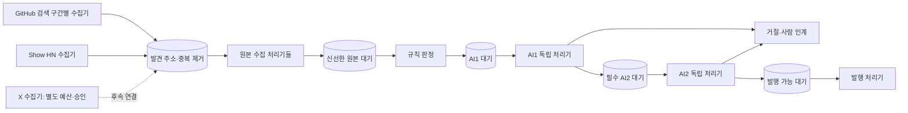
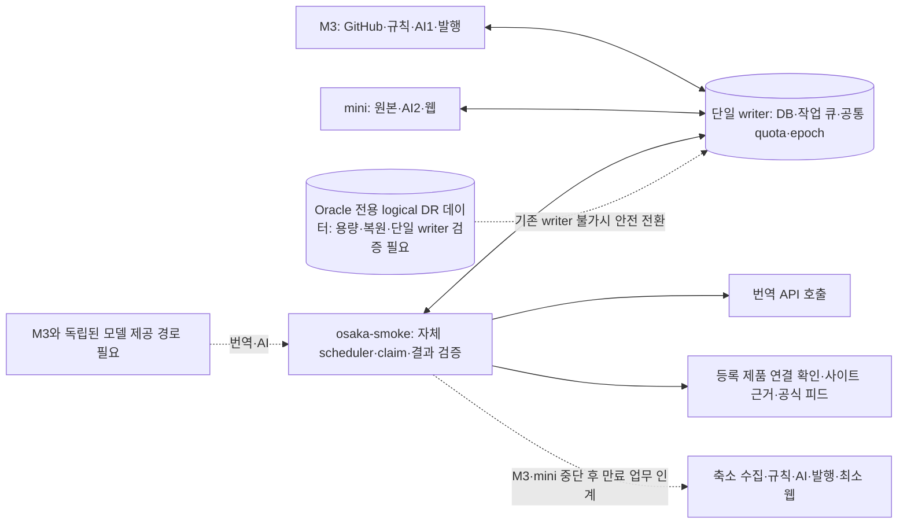

# 수집·검수 처리량 2배 개선 설계안

상태: **설계 승인·PR 단위 실행 시작**. 2026-10-15 사용자가 PR 계획과 실행을 승인했다.
구현·배포 상태는 [PR 실행 순서표](../plans/2026-10-15-pipeline-pr-roadmap.md)를 따른다.
목표는 여러 수집기가 후보를 모으는 동안 AI 검수가 독립적으로 계속 처리해 다음 단계로 넘기는 것이다.
이 문서가 2배 달성·배포·신규 발굴 재개를 뜻하지 않는다.

시각 비교: [이전·변경 흐름도와 주요 변경 6개](../../design/2026-10-15-pipeline-two-times/index.html).
로컬 브라우저에서 열면 단계 설명·변경 강조·장애 상황별 설계 동작을 확인할 수 있다.

## 1. 목표와 기본 조건

- 주 지표: **필수 심사를 끝내고 승인/거절이 확정된 고유 후보·입력 세대 수/시간**.
  AI2가 필요한 승인 후보는 AI2까지 완료해야 센다. 각 후보는 비교 구간당 최대1회만 세며, 재심사 세대는 별도 지표로 보고한다. 같은 입력의 재시도·중복·예비 표를 더하지 않는다.
  규칙만으로 종료된 후보, 사람 인계, AI1만 완료, 캐시 재사용, 실제 발행 수는 각각 별도로 보고한다.
- 같은 입력 분포·모델·프롬프트·검증·발행 조건에서 새 처리량이 기존 대비 **2.0배 이상**이어야 한다.
  단순 수집 건수 증가, 승인율 증가, 강제 보류 전환으로 목표를 대신하지 않는다.
- 답변 전 비용 가정은 **현행 모델과 비용 상한 유지**다. 처리량 증가에 따라 시간당 토큰 소모가 늘 수 있다.
  남는 모델 용량이 없으면 실행 분리만으로2배를 보장할 수 없다. 그 경우 별도 serving 용량/비용안을 보고한다.
- 운영 DB·수집 API·모델 제공자의 제한, 원본 신선도, 사람 결정, 심사 정책을 유지한다.
  신규 GitHub/Show HN 발굴의 기존 중단은 이번 설계 조사에서 해제하지 않았다.
  설계 승인 후 구현·격리 검증을 거쳐 제한된 재개를 배포 단계에 포함한다.
- X는 별도 osaka-smoke 서비스의 UTC 하루10읽기/목적 승인 gate를 유지한다.

## 2. 실제 확인한 현재 상태

코드 기준: 로컬4bcab04, 운영347d647. 읽기 시각14:16–14:18 KST.

| 확인 | 결과와 의미 |
| --- | --- |
| 수집→검수 연결 | frontier/documents/candidates/review attempts/second reviews에 영속 저장하며 다음 job을 트랜잭션 안에서 요청한다. 이미 DB 대기열이 있어 수집 완료 전체를 기다릴 필요는 없다. |
| 실행 경계 | crawler와 reviewer는 별도 역할이다. crawler 내부5lane은 병렬, reviewer의 규칙/AI1/AI2/감사/소개 검수는 같은 main lane에서 차례 실행한다. |
| 실행 복제 | role lease 때문에 같은 crawler/reviewer 복제본을 늘려도 active는 하나다. M3 active, mini standby다. |
| AI1 | reviewConcurrency4. 내부40초 tick, gateway 호출24초+2초 여유를 요구하며 최대16시작. 긴 호출 후 남는 tick으로 슬롯을 다시 채우지 못할 수 있다. |
| AI2 | 내부108초 tick/동시4, 필수 최대 호출시간을 남겨야 시작한다. 현재는 AI1과 겹치지 않는다. |
| 이어 처리 | AI1/AI2는 ready continuation을 요청하지만 worker의 즉시 재실행 특례는 sources lane에만 있다. 다른 reviewer job을 방문한 뒤 poll을 기다린다. |
| 소유권 | job 하나당 lease 하나. AI1 claim은 다른 job token의 running을 owner_changed로 대체한다. AI2는 단일 job lease에 기대며 개별 실행 claim이 없다. 현재 코드의 무조건 복제는 안전하지 않다. |
| 운영 유입 | seed/HN not_before2100. 실제 실행 가능 fetch/규칙/AI1/AI2/발행 대기 모두0, admission 조회 timedOut=false. |
| 최근1시간 신규 AI | AI1 automatic attempt0, AI2 reviewed0. 현재 유입의0건/시간을 최대 용량으로 사용하면 안 된다. |
| 같은 시간 발행분 감사 | campaign4/OSS120 활성. 완료240항목(승인152/거절87/보류1). 신규 후보 심사 처리량과 합치지 않는다. |
| reviewer 시간 | 감사 job60틱, 실행시간 합1,415.022초(23.58분), p50 22.741초/p95 32.131초. 실제 모델 시간·최대 처리량과 구분한다. |

이전8건 모델 실험은 OSS 동시2→4에서733→766성공/시간 환산으로 약4.5% 증가였다.
이는 짧은 모델 단독 실험이며 현재 파이프라인 기준값이 아니다. 이번 작업에서 재실험하지 않았다.

근거 파일: `scripts/worker.ts`, `lib/jobs/{catalog,runner,control,role-leader}.ts`,
`lib/crawl/jobs/{fetch,judge,agent-review,second-review,product-audit}.ts`,
`lib/crawl/{repository,agent-review-repository,second-review,discovery-admission}.ts`.
관련 실측: [기존 용량 측정](../../operations/2026-10-14-pipeline-capacity-measurement.md).

## 3. 대안 비교와 선택

| 안 | 장점 | 한계 | 판단 |
| --- | --- | --- | --- |
| PostgreSQL 대기열 유지 + 단계별 실행·소유권 분리 | 기존 원본·심사·감사 장부와 트랜잭션 인계를 활용. 여러 수집기/독립 AI 처리와 장애 복구 가능 | 개별 claim과 모든 결과 쓰기의 fencing을 먼저 바꿔야 한다 | **추천** |
| 기존 worker 내부 lane/동시성만 추가 | 작게 시도할 수 있고 단계 간 기다림 일부 제거 | 프로세스 장애 범위와 role 복제 제한이 남으며 global 모델 한도 없이 부하가 겹친다 | 중간 검증으로만 사용 |
| Redis/Kafka 등 새 큐 | 큐 서비스의 운영 기능 활용 가능 | DB 결과와 큐 전달의 이중 쓰기·재전달·새 인프라 운영을 해결해야 한다 | 첫 개선에서는 도입하지 않음 |

## 4. 목표 흐름과 수집 제어

- 발견은 정규화한 저장소/URL 식별자·출처·발견 시각·검색 cursor를 저장한다.
  각 수집기는 source/query/time-window 단위로 겹치지 않는 작업을 가져간다.
  페이지 실패는 해당 구간만 재시도하며 다른 수집원과 AI 처리를 막지 않는다.
- 검색 결과 본문을 모두 즉시 수집하지 않는다. **많이 발견해 보관하는 대기열**과
  **비용이 큰 원본 수집/검수 준비 대기열**을 분리한다. 발견 key의 TTL·저장량 한도와
  원본의 신선도는 구별한다. 기존 정체된 source를 재수집하는 작업도 별도 우선순위로 둔다.
- 원본 수집은 첫 배포에서 현행 동시3을 유지하고, 신선한 AI 입력을 충분히 공급하는지 측정한다.
  부족할 때만 격리 부하 검증으로 동시6을 비교한다. 실제 HTTP 한도·origin별 직렬화는 공유한다.
- 버퍼는 고정 후보 개수만으로 정하지 않는다. 실측 지속 검수량을 R로 두고
  신선한 검수 준비량은 **약2시간분을 목표**, **6시간분을 상한**으로 조절한다.
  24시간 원본 유효기간보다 앞서 처리할 여유를 두며, 실행 가능 대기의 최고 나이도 함께 검사한다.
- R이 아직 없으면 기존 admission의500/1000건·나이/hysteresis를 유지한다.
  새로운 시간 기반 제어는 기준 용량 검증 후에 켠다. 최초 부하를 무제한으로 열지 않는다.
- 발견 key 저장은 검수 버퍼가 가득 차도 저장량·외부 API 예산 범위에서 계속할 수 있다.
  무한 적재는 하지 않는다. 수집기 수가 늘어도 같은 인증의 GitHub 한도를 중복 배정하지 않는다.

## 5. 실행과 개별 소유권

논리 처리 단위는 발견, 원본, 규칙, AI1, AI2, 배경 재검수/소개, 발행이다.
공개 근거·스캔·별 갱신은 신규 원본/필수 근거 경로의 용량을 잠식하지 않도록 별도 실행·예산을 갖는다.
모든 단위를 첫 배포에서 무조건 별도 컨테이너로 늘리지는 않는다. 코드 경계와 소유권을 먼저 검증하고,
지연이 확인된 원본/AI1/AI2/배경 작업부터 독립 프로세스로 배포한다.

**필수 선행 변경:** role/job lease는 스케줄·조정과 기존 주/예비를 위해 유지하되,
여러 item consumer의 실행권을 job token 하나로 표현하지 않는다.

- PostgreSQL에 stage+work-key가 유일한 개별 실행 lease를 둔다.
  원본은 frontier identity, AI1은 candidate identity, AI2는 vote identity가 work-key다.
  input/source/policy/generation/model 식별자는 lease가 본 입력에 바인딩한다.
- 짧은 트랜잭션에서 준비 항목을 `FOR UPDATE SKIP LOCKED`로 선택하고 owner/boot/token/만료를 기록한다.
  네트워크/LLM 호출 중 DB transaction/연결을 점유하지 않는다.
- 결과 쓰기는 **개별 token 유효성 + 현재 입력·사람 결정·정책·필수 모델 독립성**을 함께 대조한다.
  job-lease writer와 item-lease writer는 명시적으로 구분하며, 검증 없는 legacy fallback을 새 consumer에 열지 않는다.
- 다른 worker의 살아 있는 running은 건너뛴다. 소유자가 다르다는 이유만으로 supersede하지 않는다.
  만료/lease 상실 뒤 재할당하고 늦게 돌아온 이전 실행의 저장은 거부한다.
- 결과 저장과 다음 단계 요청을 같은 transaction으로 commit한다. DB 재시작·전달 중복에도 후보는 유실되지 않는다.
  실제 외부 API 호출의 exactly-once는 보장하지 않는다. crash 재호출 가능성은 기록하되 확정 결과는 멱등 적용한다.
- 새 consumer는 기존 job 독점 실행과 같은 항목을 동시에 쓰지 않는다.
  stage별 mode를 DB에 두고 producer 신호를 유지한 채 이전 claim 중단→inflight drain→새 claim 활성화한다.
  rollback은 역순이며 새로운 token을 폐기한 뒤 기존 handler를 되살린다.
- 원본/AI worker가 죽어도 다른 stage는 준비된 항목을 계속 처리한다. M3/mini 분산은 개별 claim으로 중복을 막는다.
  DB와 모델 서버가 공통 의존성인 점은 남는다.

## 6. AI가 쉬지 않되 과부하를 만들지 않는 조건

- AI1·AI2는 각 준비 대기를 독립 소비한다. 한 stage의 큰 묶음 완료를 기다리지 않고
  항목 저장 즉시 다음 stage가 처리한다. 빈 대기열에서는 모델을 부르지 않는다.
- 슬롯이 비면 다음 항목을 즉시 채운다. 일정 길이의 최대 호출시간을 tick 끝마다 버리는 대신,
  개별 호출 deadline·소유권 heartbeat·graceful shutdown으로 제어한다.
  transient 실패는 항목 backoff, provider 장애는 해당 provider circuit breaker로 분리한다.
- **모든 실제 gateway 호출 경로**에 DB 기반 공통 슬롯을 적용한다.
  신규 AI1/AI2뿐 아니라 감사·소개·검색어·번역·대체 모델도 포함해야 총량 제한이 성립한다.
  per-provider와 underlying model capacity group을 함께 설정하며 이름 alias로 한도를 우회하지 않는다.
- 초기 보수적 배치는 reviewer 호출 합4, text 합4를 기준으로 gateway 전체 합8 이내로 둔다.
  이는 **새 공통 예산의 초기 배정안**이며 현행 시스템 전체 상한이나 최적값/제공자 허용량 실측이 아니다.
  공개 웹 검색의 질의 번역도 `search-translation.ts`→`translate.ts`로 gateway를 호출하므로 함께 제한한다.
  웹 replica scope의 permit 쓰기는 primary DB로 보내고, 슬롯 대기는 실패/attempt/fallback 횟수와 분리한다.
  제공자 실제 제한이 더 낮으면 그 값이 우선한다. 실험은 AI1/AI2 각2를 출발점으로 공유4 안에서 비교한다.
- 먼저 슬롯을 얻은 배경 작업이 신규 검수를 계속 밀어내지 않도록 신규/2차/배경 간 가중 공정 배분을 둔다.
  안 쓰는 몫은 빌려 쓰고, 오래 기다린 배경도 일정 몫을 받는다. 감사/소개 검수를 영구 정지시키지 않는다.
  슬롯을 기다린 시간은 모델 timeout/실패 횟수와 분리한다.
- 모델·프롬프트·입력 근거·승인 임계값은 처리량 개선 때문에 낮추지 않는다.
  현행 성공 재사용만 유지하며 원본/정책 변경 시 기존 결과를 유효한 승인으로 취급하지 않는다.

## 6.1 재검토 — 출처별 분리와 세 서버의 상시 업무

사용자가 crawler/worker 분리 개선과 Oracle의 필수 활성 업무를 요청했고, 이어
**M3·mini가 모두 멈춰도 Oracle이 나머지 업무를 인계하며 번역·등록 후 관리를 계속**하도록 요구했다.
이 요구를 반영한 설계다. 아래 신규 역할·DB 복구·모델 대체 경로는 아직 구현/배포하지 않았다.

### 먼저 바꿀 실행 경계

1. 현재 `product-evidence-refresh`는 crawler의 별도 sources lane에서 이미 병렬 실행된다.
   같은 crawler 복제본이나 lane 이름만 늘려 처리량이 늘었다고 보고하지 않는다.
2. 작업 소유권을 job/제품에서 **출처·단계별 item**으로 내린다. 현재 productId modulo3은 origin 분할이
   아니며, GitHub due가 섞인 제품은 quota 대기 때문에 canonical site도 기다린다. 출처별 claim으로
   GitHub 호출 없이 가능한 사이트 갱신을 계속한다. 사이트 성공을 GitHub/제품 전체 완료로 세지 않는다.
3. 공통 HTTP permit은 실제 redirect 각 hop에 적용하고 본문 완료/취소까지 보유한다.
   `acquireOrigin`의 process-local map과 현재 `fetchCapped`만으로 서버 간 origin 제한이 생기지 않는다.
4. 정상 refresh·관리자 개별 요청·catch-up에 명시적인 공정 배분을 둔다. custom helper가 전체 job lease를
   계속 재획득하며 공식 `product_refresh_requests`를 밀어내는 현상을 새 구조에서도 재현하지 않는다.
5. Oracle로 HTTP/번역 실행을 옮겨도 같은 abcllm 모델의 제공 용량은 늘지 않는다. 모든 모델 alias·
   fallback·배경 호출이 공유 슬롯을 사용하며 초기 AI1+AI2 합4와 기존 비용 상한을 유지한다.
6. 실제 facts/link 갱신96h·release feed6h와 신규 심사 원본24h 유효기간을 구분한다.
   이전 설정으로 예약된 next_attempt_at은 남을 수 있으며, 주기 연장/오류 이력 삭제를 적체 완료로 세지 않는다.

### 선택한 상시 배치

**세 서버는 같은 업무 종류를 실행할 수 있도록 준비하고, 아래 표는 평소의 우선 담당만 뜻한다.**
사용자가 mini의 모든 업무를 M3와 Oracle에서도 실행할 수 있는지 확인한 요구를 명시한다.
현재 M3/mini는 같은5개 role의 primary/standby 코드 구성을 이미 사용한다. Oracle의 공통 runtime·
권한·모델/검색 의존성과3서버 인계는 아직 배포/검증 전이다.

| 서버 | 평상시 실제 담당 | 장애 시 담당 |
| --- | --- | --- |
| M3 | GitHub 발굴·인증 근거·스캔, 규칙·AI1, 발행 | mini/Oracle 업무의 지정 예비. Oracle을 거치지 않고 기존 공통 DB에서 만료 업무를 인계할 수 있도록 한다. |
| mini | 신규 후보 원본 수집, AI2의 활성 consumer, 기존 웹 | M3 업무의 우선 예비. 단순 role replica 활성화가 아니라 개별 item 소유권으로 분담한다. |
| **Oracle osaka-smoke** | **번역**, **등록 제품 연결 확인**, **canonical-site 근거·공식 피드 HTTP**의 상시 실행 | 자체 scheduler·control과 나머지 역할의 최종 예비. M3·mini 동시 장애 시 축소 처리량으로 이어받는다. |
| Oracle의 기존 X 서비스 | UTC 하루10읽기 장부·분리 서비스 유지. 현재 실제 API gate 닫힘 | 장애에도 예산/목적 gate 유지. 설치·heartbeat를 위 상시 업무의 실제 처리로 세지 않는다. |

Oracle 대상은 **surfguide / ap-osaka-1 / osaka-smoke**, **onetwoday가 아니다**.
05:54 UTC 읽기 전용 관측은 ARM64/1 CPU/메모리5,903MiB(가용5,264MiB)/루트여유20GiB/load0.00이다.
번역은 외부 모델 API를 부르며 Oracle에 대형 LLM을 올리지 않는다. 정상 HTTP 합2·origin별1,
번역 실제 호출1부터 시작하는 것은 측정용 배정안이며 uptime 전체 수요를 감당하는 최종값은 아니다.
HTTP2와 번역1은 서로 다른 예산이지만 CPU·메모리·DB pool 전체 상한과 모델 공통 슬롯을 함께 지킨다.

실행 단위는 역할 전체 이전 대신 versioned job 배치를 사용한다. 제안 역할은
`translation`(아래3종), `product-health`(uptime), `site-evidence`(canonical source),
`official-news`(news)이며 기존 text/crawler/maintenance에서 해당 claim을 배타적으로 넘긴다.
각 통로의 실행·timeout·대기·실패를 따로 관측하되 가벼운 supervisor/공유 bounded pool을 사용할 수 있다.
role catalog/DB 권한·pool/readiness/관리자·배포·fallback 목록은 같은 전환 버전으로 맞춰야 한다.
정상 preferred host와 fallback 순위는 역할마다 다르다. Oracle 역할은 Oracle→M3→mini,
M3 역할은 M3→mini→Oracle, mini 역할은 mini→M3→Oracle로 둔다. 유효한 현 소유자를
복귀한 선호 host가 선점하지 않으며 만료 또는 계획 drain 이후에만 다음 epoch를 선출한다.

### 공통 실행 지원과 처리 용량

- mini에 배정한 원본 수집·AI2·웹/관리자뿐 아니라 전체 crawler/reviewer/publisher/text/maintenance,
  새로 분리한 역할과 scheduler를 M3와 Oracle에서도 실행할 수 있는 release/설정/권한을 준비한다.
  단계별 모델·검증기·입출력 계약과 사람 결정 보호는 같은 버전으로 맞춘다. 평소 담당 서버가 해당 업무의
  유일한 실행 가능 서버가 되지 않게 한다. Oracle은 최소 웹/관리자에서도 같은 데이터·관리 기능을 유지한다.
- 각 host에 지원 업무·release·최근 canary·DB/모델/embedding/자격 증명 상태를 capability로 기록한다.
  파일/이미지가 있다는 이유로 준비 완료로 표시하지 않는다. 실제 원본 저장·2차 판정·발행·번역·
  연결 관측·관리자 화면과 scheduler의 실행을 각 host에서 검증해야 공통 실행 지원 완료다.
- M3는 mini 장애 시 지정 순위로 해당 일을 인계한다. M3·mini가 모두 멈추면 Oracle이 나머지 업무를
  인계하며1CPU 비상 예산/공정 배분을 적용한다. 세 서버가 같은 종류의 일을 실행할 수 있다는 조건과
  세 서버의 최대 처리량이 같다는 조건은 구분한다. 동일 item의 동시 실행을 허용하는 뜻도 아니다.
- 모델 **호출 업무**의 이식과 모델 **추론 서버**의 이식은 별개다. 기존 대형 MLX 모델을 Oracle에서
  같은 속도로 실행한다고 가정하지 않는다. 독립된 API 경로가 없으면 해당 AI 업무는 준비 미완료다.
  검색 embedding도 현재 `EMBEDDING_URL`의 Mac llama-server에 의존한다. Oracle에서도 의미 검색/
  embedding 갱신까지 이어가려면 동일 모델 식별자 `bge-m3-f16@daec91ff`·1024차원·동등한 전처리를
  검증한 생존 endpoint가 필요하다. 임의 다른 벡터를 기존 index에 섞지 않는다. 그 전의 낱말 검색
  다운그레이드를 전체 기능 인계 완료로 보고하지 않는다.
- ARM Node·native dependency·CLI/로그인·외부 API·DB권한·DNS/터널은 각 host에서 canary한다.
  Oracle에서 모든 container를 M3의 자원 상한 그대로 동시에 띄우지 않고 공유 bounded 실행 예산을 쓴다.

### Oracle 번역 — 독립된 대기열과 원문 검증

- `reason-translate`, `product-tagline-ko`, `product-translate`를 Oracle의 독립 text 소비 통로로 배정한다.
  `crawl-tagline`은 신규 후보 소개 생성이고 번역과 다르므로 별도 작업 유형/공정 배분을 유지한다.
- 실제 설정 모델은 `[MLX] gpt-oss-120b`, API는 `abcllm-api.brut.bot`이다. Oracle CPU에서 추론하지 않는다.
- 원문 hash·제품 세대·locale·필드·정책 버전과 현재 공개/요청 적격성을 대조한다. 결과 기록 전 ownership을
  다시 검사하고 기존 필드별 검증기·attempt/backoff·품질 거절을 보존한다. 낡은 번역이 새 원문을 덮지 않는다.
- 현재 요청 기반 다국어 필드는 수요가 있는 항목만 처리한다. 전체 언어 catalog backfill을 자동 추가하지 않는다.
  전체 text role을 통째로 옮겨 로컬 embedding·검색어 검수·저장소 재검수를 함께 이전하지 않는다.
  keyword `api-stop` 등 개별 중단도 유지한다. 공통 text lane의 긴 잡 때문에 번역이 밀리지 않도록 분리한다.
- 기존 M3 text가 이동 잡을 새로 선점하지 않게 mode 전환하고 진행 항목을 drain한 뒤 Oracle 활성화한다.
  정상 예비는 M3/mini에 두어 Oracle 자체 장애에도 번역을 이어받는다.

### 등록 후 연결 확인 — 관측과 자동 내림 입력을 구분

현재 `uptime-ping`은 `safeFetch` null을 status0으로 합치고403도 실패로 기록하며,2xx/3xx면 연속 실패0으로
초기화한다. 목록에서는 실패3회부터 숨겨질 수 있고10회에서 audited banned 전이가 적용된다.
현재 `product_health`는 slug별 현재 상태와 일 집계이며 관측 host/지역/실패 종류/원 URL의 이력이 없다.
**Oracle를 기존 maintenance의 active replica로 켜 바로 카운터를 쓰면 지역 차단이 제품 폐쇄로 바뀔 수 있다.**

- 먼저 observationID·scheduled slot·URL/세대·관측 시각·host/지역·HTTP/transport 실패 종류를 남기는
  원시 관측 계약과 멱등 CAS를 만든다. 현 `recordPing`은 자체 최소6h 간격/새로운 checkedAt/관측ID를
  보장하지 않으므로 remote 재전송이 여러 실패로 누적되지 않도록 해야 한다.
- 지역 비교 단계에서 Oracle은 실제 HTTP를 수행하되 원시 관측만 남긴다. 기존6h slot/공유 origin permit을
  지키며 비교 때문에 중복 요청을 쏟지 않는다. 같은 URL·비슷한 시점의 M3/mini 증거와 차이를 기록한다.
- Oracle의 DNS/라우팅·대표 정상 사이트들의 실패가 동반되거나 지역403 원인이 분리되지 않은 경우
  `observation_hold`로 남긴다. 이를 성공/폐쇄/사람 판단으로 바꾸지 않고, 기존 authoritative 상태를 유지하며
  검증된 재확인을 요청한다. 미확인 상태/마지막 관측 나이와 실제 적체를 관리자에 드러낸다.
- 검증된 Oracle 관측이 기존 카운터에 들어갈 수 있는지 admission gate로 판단한 뒤 권한을 이전한다.
  **유효한 연속 접속 실패10회 자동 내림과 감사/CDN 기록 정책은 유지**한다. 입력 증거가 없는 동안에는
  새 record뿐 아니라 기존 `nextUptimeAutoBanTargets` sweep/최종 commit에도 hold를 적용한다.
  숫자 기준을 완화하거나 오류를 삭제하는 변경과 구분한다. 이 gate 자체도 아직 미구현이다.
- 장애 시 독립 확인 지점까지 없어지면 불확실한 실패를 보류하고 양성 관측과 명백한 오류를 구분한다.
  사이트 점검 지속과 모든 제품의 즉시 자동 내림을 같은 완료 조건으로 묶지 않는다.

### 등록 후 근거·공식 피드

- canonical site는 `documentation + canonical_site`부터 분리한다. 완전한 본문을 현행2MiB 안에서 읽고
  prefix로 저장소 관계의 유일성을 주장하지 않는다. SSRF/DNS를 매 hop 검증하고 압축 해제 뒤 상한도 지킨다.
- 공식 `news-refresh`의 활성 출처 feed/npm/sitemap·본문 수집을 같은 Oracle HTTP 예산 안에서 처리한다.
  출처 on/off·autoApprove·seen cursor·dedup·실패 재시도 의미를 유지한다. GitHub 인증 근거는 M3에 남긴다.
- 동일 URL·body digest·파서 버전에 맞는304만 유효 캐시로 재사용한다. cacheless304/다른 final URL304/
  truncated 원문은 정상 성공으로 바꾸지 않는다. 원시 본문을 장기 로그로 남기지 않는다.
- source 결과와 다음 요청을 원자 저장하고 product refresh request는 모든 필수 출처가 끝나야 완료한다.
  출처별 progress·관리자 요청 우선순위·catch-up 몫을 유지한다. 만료 token/입력 변경/공개 해제는 저장을 거부한다.

### 연결 방식 — M3 중계에 종속되지 않는 실행

**Oracle 자체 실행기+스케줄러, 생존 공통 DB 직접 접속을 기본 경로**로 선택한다.
앞서 검토했던 M3-only HTTP broker는 M3·mini 동시 장애 요구를 충족하지 않아 최종안에서 제외한다.
필요하면 작은 claim/result facade를 Oracle 또는 복구 가능한 생존 control에 두되 M3만 통해 일감을 받지 않는다.

- role/item DB 접속은 Tailscale writer의 좁은 경로·최소권한 전용 사용자/실행 함수로 제한한다.
  migration/admin/전체 DB 읽기 권한을 배포 편의로 주지 않는다. 관측·번역·DR 승격 권한은 분리한다.
- Oracle 전체 client/backend budget을 검증한다. 역할별 무조건 pool1은 lease heartbeat+write가 겹치는
  기존 경로에서 충분하다고 검증되지 않았다. 단일 공유 pool과 heartbeat 여유를 측정해 합계 상한을 정하고,
  DB transaction/connection을 외부 HTTP·모델 응답 동안 점유하지 않는다.
- 실제 writer100.99.209.55:6432 TCP5/5(41.8–88.6ms), DERP Tokyo42–45ms는 확인했다.
  인증 SQL·최소권한·PgBouncer 여유·지속 연결은 아직 미확인이다. TCP 성공을 배포 준비로 세지 않는다.
- ARM 고정 release를 Oracle에 미리 보관하고 nonroot systemd 재시작·로컬 health·오프사이트 상태 보고를 둔다.
  DNS/터널·웹·비밀 파일·복구 명령도 M3/Dokploy에서 파일을 가져와야만 작동하는 구조를 피한다.
  외부 작업용 자격 증명은 필요한 서비스에만 제공하고 장애용 고권한 자격은 암호화·별도 해제로 관리한다.

## 6.2 Oracle 최종 생존 — 앱 장애와 데이터/모델 장애를 모두 검증

### 장애 범위별 계약

| 장애 | Oracle가 수행할 동작 | 선행 조건/현재 상태 |
| --- | --- | --- |
| M3만 중단 | mini가 지정 우선 역할 인계, Oracle 상시 번역·유지관리 지속 | 현재2후보 lease를3서버/분리역할로 확장해야 함. |
| M3·mini 중단, 공통 DB·모델 생존 | Oracle 자체 scheduler가 만료된 나머지 역할을 맡아 기존 queue 처리. 최소 웹·관리자 경로도 복구 | Oracle runtime·권한·독립 scheduler·DNS/터널·직접 SQL 모두 준비/시험 필요. |
| 기존 DB까지 중단 | 검증된 Oracle DR 데이터 경로로 복원/승격하고 단일 writer 확정 뒤 새 epoch로 재개 | 현재 NoMoreVibe Oracle DB 복원/승격 검증 없음. backup만 존재한다고 무손실·즉시 복구 주장 금지. |
| M3에 종속된 모델까지 중단 | 독립 provider/model 경로에서 동일 품질 검증·예산을 거쳐 번역/AI를 재개 | endpoint가 외부인 것만으로 모델 host 생존이 입증되지 않음. 현재 독립 대체 경로 미검증. |
| 네트워크 분할로 기존 writer 생사 불명 | 독립 fencing 증거/선출 권위 확인 전 새 DB 쓰기·발행·자동 내림 보류 | timeout만으로 old primary를 죽었다고 간주하지 않음. 임시 관측을 완료로 세지 않음. |

### 데이터 복구가 별도 필수 작업인 이유

06:04:43 UTC 읽기 전용 측정에서 NoMoreVibe DB는 **9,699,808,947bytes(약9.03GiB)**, PostgreSQL17.10이며
writer다. WAL archiver는 archived26,333/failed0/최근06:03:11였지만 보관 위치·누락 없는 WAL 연속성·
복원 성공은 미검증이다. replication행의 state/lag가 현재 계정에 NULL이라 동기 복제/무손실을 확정하지 않는다.
Oracle에는 현재 NoMoreVibe DB·PostgreSQL/PgBouncer/runtime 패키지/복원 구성이 없다.
`deppy` 오프사이트 sql.gz 약2,024MiB는 다른 제품 백업이며 NoMoreVibe 복구 증거로 사용하지 않는다.

- 실제 writer는 **x86_64**, Oracle는 **aarch64**다. 이 조합에 physical basebackup+원본 WAL을 직접
  적용하는 standby를 구성하지 않는다. PostgreSQL17은 물리 log shipping에 동일 하드웨어 아키텍처를 요구한다.
  [PostgreSQL17 물리 standby 조건](https://www.postgresql.org/docs/17/warm-standby.html#WARM-STANDBY-PLANNING).
- 최종 연속 처리 목표는 **NoMoreVibe 전용 cross-architecture logical replica**로 설계하고,
  별도 logical dump의 실제 복원 시험을 중간 안전망으로 먼저 수행한다. 백업 수동 복원만 구현한 상태를
  최종 자동/연속 인계 완료로 세지 않는다. 버전·확장·데이터형·암호화 키·업로드 저장소와
  큐/사람 결정/audit 일관성을 검사한다.
  06:06:57 UTC에 보이는 non-template DB 합만 **21,252,998,652bytes(19.79GiB)**다.
  physical 전체 cluster 복제는 현 Oracle 여유20GiB에 데이터만으로 거의 차므로 전용 용량 확보 전 부적합하다.
  이 합도 WAL/일부 cluster 파일까지 포함한 disk 측정은 아니다. Oracle 전용 logical DB는 앱 데이터에
  범위를 좁히되 DDL·sequence·large object·replica identity·누락 table·최종 적용 시점·전환 reconciliation을
  검증한다. 논리 복제는 schema/DDL와 sequence 상태를 자동 복제하지 않으므로 migration 순서·고유ID
  재개·동기화 실패 시 승격 차단을 별도 구현한다.
  [PostgreSQL17 논리 복제 제약](https://www.postgresql.org/docs/17/logical-replication-restrictions.html).
- 루트여유20GiB에9GiB DB·logical subscriber의 자체 WAL·복원 임시 공간·Node/최소 웹·로그가 안전히 들어간다고 가정하지 않는다.
  actual cluster/증가율/retention을 측정하고 용량 확보안을 확정해야 한다. 새 volume/과금 설정은 이 문서로 변경하지 않는다.
- logical replica와 backup 복원은 RTO/RPO가 다르다. 동기 보장 없이RPO0/즉시 자동승격을 표기하지 않는다.
  복원 시험의 실제 마지막 적용 시각·복구 시간·누락 작업 수를 기록하며 이미 외부에 반영된 발행/CDN·
  사람 결정과 재조정한다. 보호할 결정이 유실된 상태로 자동 공개/내림을 재개하지 않는다.
- old writer를 확실히 차단하고 Oracle 단일 writer를 확정하는 독립 제어 경로가 필요하다.
  old DB에 남은 role/item lease만으로 DB가 두 개가 된 split-brain을 방지할 수 없다.
  승격 뒤 새 DB epoch와 token으로 stale 결과를 거부하고 복귀 서버는 새 writer로 재가입한다.
  기존 primary가 임의 복귀해 권한을 선점하거나 두 DB를 양방향 병합하지 않는다.
- writer/token fencing은 장애 직전 외부에 이미 들어간 HTTP/모델 호출을 취소했다는 증거가 아니다.
  복원으로 공통 slot/permit 장부가 되감긴 경우, 구 호출의 종료를 확인하거나 마지막 가능한 발급 시각의
  최장 hard deadline+시계 오차 여유가 지날 때까지 새 호출 발급을 보류하는 drain barrier를 둔다.
  최장 기한을 증명하지 못하면 독립된 provider/예산 권위로 재조정하기 전 새 호출을 열지 않는다.
  원격 제공자가 client timeout 이후도 실행한다면 provider 종료 확인/허용된 별도 격리 예산 없이는
  복원 직후 무제한 재발급하지 않는다. 재시도로 늘어나는 비용은 완료량과 별도 기록한다.

### 독립 모델과 비상 작업 우선순위

번역은 실제 `[MLX] gpt-oss-120b`/abcllm API 사용 중이나 그 실제 serving host가 M3와 독립인지 확인이 필요하다.
M3-serving 모델이 끊겨도 번역이 계속되려면 별도 생존 provider·모델·키·DNS 경로를 갖춰야 한다.
대체 모델은 기존 source hash/locale/필드 검사와 품질 집합을 통과하고 예산/circuit breaker를 적용한다.
번역 failover를 심사모델 자동교체 허가로 확장하지 않으며 각 용도에 승인된 모델만 사용한다.
독립 모델이 없으면 HTTP 관리는 계속하되 번역은 정확한 원문과 재시도 상태로 대기하며 완료로 세지 않는다.

1 CPU 비상 모드는 역할별 pool을 무제한 합치지 않고 **관리·DB 안전성→번역·연결 확인·발행후 반영→
이미 승인된 발행→기존 준비 후보 규칙·AI→근거 catch-up→신규 발굴** 순으로 공정 배분한다.
모델 호출1·작은 batch부터 시작하되 최소 CPU/메모리·DB lease heartbeat 여유를 보장한다.
사람 보류/모든 기존 pause/keyword api-stop/X10읽기/API reserve/Cloudflare 무료량80% 제어는 보존한다.
신규 발굴 중단을 장애 모드가 임의 해제하지 않는다. 임베딩 등 M3 로컬 기능은 검증된 대체 없이
다운그레이드 상태로 드러내고 기존 결과를 보존한다. 비상 처리량은 정상2배 목표와 별도 측정한다.

### 전환·복구 완료 조건

1. item/source/observationID 소유권·CAS·공유 origin/model permit·공정 배분·Oracle3순위 선출/epoch를 먼저 검증한다.
   현행 primary/standby2종과 M3/mini 이름 고정 readiness도 갱신한다. 세 번째 standby를 추가하는 것만으로
   mini 우선/Oracle 최종 순서가 생기지 않는다.
2. 번역과 canonical/news의 기존 consumer만 drain→mode전환해 Oracle 실제 처리를 확인한다.
   canary는 실제 due canonical10고유출처, 정상 due 공식출처1개, 실제 요청 번역의 승인 저장을 각각 검증한다.
   유효304는 별도 관측으로 기록하며 dry-run/heartbeat/새 기사 강제생성을 성공으로 세지 않는다.
3. uptime은 raw 관측→지역/광역장애 비교→멱등/정책 입력 gate 검증 후 authoritative 권한을 이전한다.
   10회 정책뿐 아니라3회 목록 숨김·기존 auto-ban sweep도 장애 증거공백에 보호되는지 검사한다.
   6h 목표 주기를 따라가는 실제 처리량을 확인하고 부족하면 batch/I/O를 제한적으로 비교한다.
4. Oracle logical DR 데이터의 실제 복원·용량·논리 복제/DDL·독립 fencing과 모델 대체/최소 웹 경로를 시험한다.
   기존 앱 중단과 기존 DB/모델 동반 중단을 각각 격리 환경에서 주입하고 실제 RTO/RPO/번역 연속성·작업 보존을 기록한다.
5. 구 모델/HTTP 호출이 진행 중인 DB 전환에서 복구된 slot이 중복 발급되지 않는지 drain barrier를 검증한다.
   중단한 원서버를 되살려 늦은 결과 차단·동일 작업/실패 관측 이중 적용0·제품 상태/사람 결정 보호를 검증한다.
   failback은 drain 후 새 epoch에서 계획 인계하며,24시간 상시 세 업무와 비상 복구를 확인한다.
   Oracle 자체 중단 시 M3/mini 인계도 확인한다. X 장부·Mautic 백업은 이 전환에서 건드리지 않는다.

**단순 Oracle 서비스 등록은 최종 장애복구 완료가 아니다.** 각 장애 범위의 실처리·데이터·모델·경로가
검증되어야 한다. 현재는 이 설계에 대한 코드/인프라 작업 전 단계다.

## 7. 2배 검증과 중단 조건

1. 기준 SHA347d647과 변경 버전에 같은 고정 입력 집합·규칙·모델·별도 초기 DB/캐시 상태를 제공한다.
   실제 대표 원본을 층화해 신규/재시도/근거대기/AI2/오류가 섞인 비율을 고정한다.
   만료/사람 보류 항목을 준비된 AI 업무로 세지 않는다. 실험의 기준 시각도 동일하게 둔다.
2. 단위/통합 fixture는 상태 동등성·중복 claim·만료 재할당·늦은 저장 거부·원자 인계·전역 슬롯·pause/rollback을 검증한다.
   fixture 실행 속도를 실제 모델/인터넷 처리량으로 보고하지 않는다.
3. 실제 모델을 쓰는 격리 replay에서 준비 대기를 유지한 **30분 구간**을 기준/변경 각각 측정한다.
   충분한 서로 다른 입력이 없거나 먼저 대기가 비면 용량 측정은 미완료로 기록한다.
   결과는 격리 장부에만 기록하고 공개 제품 상태는 바꾸지 않는다. 호출 수·토큰·실험 예산을 사전에 제한한다.
4. warm/cold cache를 별도로 비교하고, 재사용·실제 모델 완료·고유 최종 완료를 구분한다.
   최종 고유 완료량 ≥2.0배, p95 전체 지연 악화 없음, 기술 실패율 ≤기준+1%p가 성능 합격 기준이다.
   입력 변화/사람 결정 덮어쓰기·중복 발행·필수 심사 누락은0건이어야 한다.
   같은 품질 평가 집합에서 잘못 승인·거절이 늘면 불합격이며 속도 합격으로 덮지 않는다.
5. 격리 합격 후 신규 발굴을 기존 외부 예산 안에서 소량 재개하고 단계별 대기 나이·drain 예상시간·DB/모델을 관측한다.
   첫 배포는30분 canary, 이후24시간 관측으로 반복 갱신 수요까지 확인한다.
   비교는 유입 충분성·입력 분포를 함께 표시하며 자연 유입이 적은 구간을2배 증명으로 쓰지 않는다.

lease 위반/사람 결정 덮어쓰기/이중 발행은 즉시 중단한다. 오류율 증가·p95 지연2배·quota429 반복·
DB pool 대기 증가가 지속되면 consumer 증설을 되돌리고 신규 유입부터 줄인다.
준비 대기가 있는데 모델 슬롯이 비는 시간과, 모델 서버가 포화라 슬롯을 기다리는 시간을 나눠 보고한다.
모델 포화가 남으면 추가 worker 배포를 멈추고 독립 serving 증설안을 비용과 함께 제시한다.

## 8. 구현 순서와 완료 보고

아래1–7의 구현·실험은 격리 환경에서 먼저 수행한다. 각 단계의 **운영 활성화 직전** PR/최신 base CI,
필요한 migration·배타 전환·rollback 준비·canary gate를 통과한다. 마지막8까지 배포 검증을 미루지 않는다.

1. 기준 데이터·지표 수집과 동일 조건 부하 재현. 운영 pause/근거 catch-up은 보존한다.
2. 공통 모델 슬롯과 개별 소유권·쓰기 fence·전환 mode를 통합 검증한다.
3. 규칙/AI1/AI2/배경 처리 분리·계속 소비를 활성화한다. 우선 검수의 실제2배 가능성을 검증한다.
4. 출처/관측별 분리·공통 per-hop origin permit·Oracle 독립 실행기를 연결해 번역·사이트/공식 피드를 실제 활성화한다.
   uptime은 지역 비교·멱등 관측·admission gate를 검증한 뒤 전환한다. Oracle이 standby만이면 미완료다.
5. Oracle 최종 logical DR 데이터 용량/복원·단일 writer·호출 drain barrier·독립 모델·scheduler/최소 웹과 장애/복귀를 검증한다.
6. 발견 구간별 consumer·원본 공급·시간 기반 버퍼 제어를 연결한다.
7. 관리자에 stage/consumer/실행 host·실제 모델 슬롯·고유 처리량·현재 대기/나이·backoff/사람 보류와 DR 준비/현재 epoch를 표시한다.
8. PR/최신 base CI, 필요한 migration, M3/mini/Oracle 순차 배포·장애 복구 검증·canary·실측 보고를 완료한다.

각 단계를 실제 결과로 갱신한다. **설계 완료, 구현 완료, 배포 완료, 2배 실측 성공**을 서로 구분한다.
사용자가 승인한 PR별 계획에 따라 구현한다. 각 PR의 활성화 조건 전에는 새 consumer·운영 설정을 켜지 않는다.

## 자체 검토와 증거 보관

선택지·주 지표·중복 단위·비용 가정·pause·freshness·품질·claim 전환·실제 모델 한계를 명시했다.
기존 대기열이 없다고 가정하거나, replica만 추가해 scale-out 된다고 주장하지 않는다.
외부 API/모델 한도 수치는 이번 조사에서 새로 요청해 검증하지 않았다. 기존 설정/코드의 상한과 구분한다.

private: `~/.config/nomorevibe/assessments/2026-10-15-pipeline-two-times/{runtime,queues}.json`.
로그: `/private/tmp/nomorevibe-pipeline-capacity-20261014/logs-two-times-design-20261015.json`,
`log-summary-two-times-design-20261015.json`. 토큰/원시 모델 입력을 설계 문서에 포함하지 않았다.
